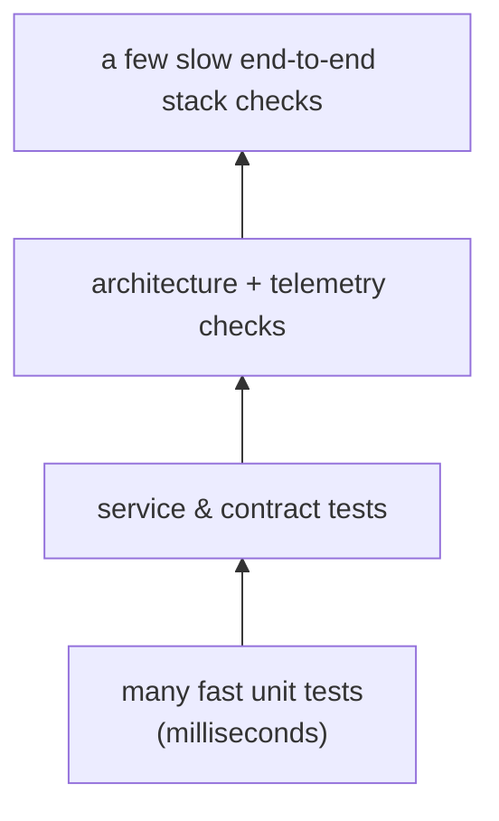

# F · 04 — Testing Guide

**Goal:** write and read tests in this repo with confidence: pytest basics, async tests, fakes vs mocks, fixtures, the kinds of tests we have, and how to run just the ones you need.
**Prerequisites:** [F · 01](01-python-for-this-codebase.md). **Time:** 1–1.5 hours.
All output below is from running the example inside this repo (so our pytest configuration applies).

---

## 4.1 Why we test the way we do

| Question | Test type | Where / how |
|---|---|---|
| Does this function/use case do what I meant? | **Unit** | next to the code, with fakes, no network or DB server |
| Does the service work behind a real HTTP API and database? | **Service/integration** | `services/<n>/service/tests/test_module.py` (SQLite for speed) |
| Do the in-process and HTTP versions of a contract behave *identically*? | **Contract** | `tests/test_contract.py`, same assertions run twice |
| Did someone break an architecture rule? | **Architecture** | `uv run lint-imports` |
| Does telemetry contain what we promise (spans, metrics, no secrets)? | **Telemetry** | `platform_observability.testing` |
| Does the *whole assembled stack* work? | **Stack/smoke** | `make stack-check` (Docker) |


> 💡 **Learning Thought — the pyramid is about cost.** Lots of cheap tests at the bottom catch most mistakes in milliseconds; a few expensive ones at the top catch what the cheap ones *cannot* (we found ten such issues in Phase A2).

## 4.2 pytest in ten minutes

A test is any function named `test_*` in a file named `test_*.py`. It passes unless an exception is raised (usually from `assert`).

Here is a complete tour. It tests a tiny use case (`Greet`) using the **same shape** as our real ones: a unit-of-work factory and a clock are *injected*.

```python
class FakeUnitOfWork:                                   # a FAKE: a simple working stand-in
    def __init__(self) -> None:
        self.outbox = InMemoryOutbox()
        self.committed = False
    async def __aenter__(self) -> Self: return self
    async def __aexit__(self, et, e, tb) -> None: ...
    async def commit(self) -> None: self.committed = True

class Greeted(IntegrationEvent):
    EVENT_NAME: ClassVar[str] = "demo.person_greeted.v1"
    name: str

class Greet:                                             # the thing under test
    def __init__(self, uow_factory, clock) -> None:
        self._uow_factory, self._clock = uow_factory, clock
    async def __call__(self, name: str) -> str:
        if not name.strip():
            raise ValueError("name required")
        async with self._uow_factory() as uow:
            await uow.outbox.add(Greeted(name=name))
            await uow.commit()
        return f"Hello {name} at {self._clock.now():%H:%M}"
```

```python
# 1. Arrange / Act / Assert. `async def` just works (asyncio_mode = "auto" in pyproject.toml).
async def test_greet_commits_and_records_an_event() -> None:
    uow = FakeUnitOfWork()
    greet = Greet(lambda: uow, FixedClock())
    assert await greet("Ana") == "Hello Ana at 00:00"
    assert uow.committed
    assert [m.event_name for m in uow.outbox.messages] == ["demo.person_greeted.v1"]

# 2. parametrize: one body, many cases
@pytest.mark.parametrize("bad", ["", "   "])
async def test_blank_names_are_rejected(bad: str) -> None:
    with pytest.raises(ValueError, match="name required"):
        await Greet(FakeUnitOfWork, FixedClock())(bad)

# 3. fixtures: reusable setup, injected by argument name
@pytest.fixture
def clock() -> FixedClock: return FixedClock()

def test_fixed_clock_advances(clock: FixedClock) -> None:
    clock.advance(minutes=90)
    assert clock.now().strftime("%H:%M") == "01:30"

# 4. a MOCK records how it was called
async def test_mock_records_calls() -> None:
    notifier = AsyncMock()
    await notifier.send("a@b.c", "hi")
    notifier.send.assert_awaited_once_with("a@b.c", "hi")

# 5. monkeypatch (change the environment) + capsys (capture printed output)
def test_env_and_output(monkeypatch, capsys) -> None:
    monkeypatch.setenv("GREETING", "hola")
    print(os.environ["GREETING"])
    assert capsys.readouterr().out.strip() == "hola"

# 6. a deliberately failing test, to learn to read failures
def test_this_one_fails_on_purpose() -> None:
    assert {"name": "Ana", "age": 31} == {"name": "Ana", "age": 30}
```

▶ **Try it** — `uv run pytest <file> -v` (real):
```
collected 7 items
…::test_greet_commits_and_records_an_event PASSED        [ 14%]
…::test_blank_names_are_rejected[] PASSED                [ 28%]
…::test_blank_names_are_rejected[   ] PASSED             [ 42%]
…::test_fixed_clock_advances PASSED                      [ 57%]
…::test_mock_records_calls PASSED                        [ 71%]
…::test_env_and_output PASSED                            [ 85%]
…::test_this_one_fails_on_purpose FAILED                 [100%]

>       assert actual == expected
E       AssertionError: assert {'name': 'Ana', 'age': 31} == {'name': 'Ana', 'age': 30}
E         Differing items:
E         {'age': 31} != {'age': 30}
========================= 1 failed, 6 passed in 1.52s ==========================
```
Notice how `parametrize` produced two test cases, and how pytest's failure message shows **exactly which key differs** — you never need to add `print` statements to see why an `assert` failed.

## 4.3 Fake vs mock vs stub — the vocabulary

| Kind | What it is | Example here | Use it when |
|---|---|---|---|
| **Fake** | A simple *working* implementation | `FakeUnitOfWork`, `InMemoryOutbox`, `FixedClock`, `StaticKeyProvider` | you care about the **outcome** (preferred) |
| **Stub** | Returns canned answers | a function that always returns `"pong"` | you need a dependency to answer, nothing more |
| **Mock** | Records *how* it was called, lets you assert on calls | `AsyncMock().send.assert_awaited_once_with(…)` | the **interaction itself** is the behaviour |

> 💡 **Learning Thought — prefer fakes; use mocks sparingly.** A test that asserts *which methods were called* breaks whenever you refactor, even if behaviour is unchanged. A test that asserts *the outcome* (the event is in the outbox) survives refactoring.
> This is why our ports are small `Protocol`s: a fake is five lines.

## 4.4 Running tests

```bash
make test                                                   # everything
uv run pytest libs/platform_core -q                         # one package
uv run pytest path/to/test_file.py::test_name -x            # one test, stop at first failure
uv run pytest -k "blank or advances" -q                     # select by NAME expression      → "3 passed, 4 deselected"
uv run pytest --lf                                          # re-run only what failed last time
uv run pytest -vv                                           # show full diffs
uv run pytest --cov=platform_core --cov-report=term-missing libs/platform_core   # coverage
make test-service s=notes-service p=services/notes/service  # isolated: only that package's dependencies installed (rule B-6)
```
Real coverage output for one library:
```
Name                                               Stmts  Miss  Cover  Missing
platform_core/clock.py                               16     1    94%   15
platform_core/container.py                           18     0   100%
platform_core/db.py                                  11    11     0%   3-36
platform_core/errors.py                              37     6    84%   22-25, 65-66
platform_core/ids.py                                 23     2    91%   32-33
TOTAL                                               157    20    87%
```
The `Missing` column lists **line numbers no test executed**. Notice `db.py` is at **0 %** — an honest gap (see Lab 3).

> ⚠️ **Trap — chasing 100 % coverage.** Coverage tells you what *wasn't* run, never that what ran is *correct*. A test with no assertions gives 100 % coverage and zero safety. Aim for meaningful assertions on behaviour, then use coverage to find forgotten corners.

## 4.5 How to test each kind of thing here

| Subject | Approach | Example in repo |
|---|---|---|
| Pure domain rule | plain function test | `domain/text.py::shout` (chapter [A1 · 07](../phase-a1/07-adding-a-service-hands-on.md)) |
| Use case | fake UoW + `FixedClock`; assert **outcome** | the `Greet` example above |
| HTTP route | `httpx.AsyncClient(transport=ASGITransport(app=app))` | `services/<n>/service/tests/test_module.py` |
| Contract | one test, parametrised over in-process **and** HTTP implementation | `tests/test_contract.py` |
| Events | publish via `InMemoryOutbox` + `InProcessEventBus`, run `OutboxRelay.run_once()` | `libs/platform_events/tests/test_events.py` |
| Auth | `platform_security.testing.TestAuth` makes keys and tokens | `libs/platform_security/tests/test_security.py` |
| Telemetry | `platform_observability.testing.install()` + assert on spans/metrics | `libs/platform_observability/tests/test_telemetry_contract.py` |
| Time | inject `FixedClock`, never `sleep` | everywhere |
| "It shouldn't leak secrets" | feed secrets through the logger, assert absence | `tests/test_redaction_and_logging.py` |

## 4.6 Habits of good tests

1. **Name the behaviour**, not the function: `test_blank_names_are_rejected`, not `test_greet_2`.
2. **One reason to fail** per test (but several asserts on the same outcome are fine).
3. **No sleeping, no real clock, no real network** in unit tests — inject and fake.
4. **Test the unhappy path** (errors, expiry, replay) as carefully as the happy one — security-sensitive code requires it (rule T-5).
5. **A bug fix starts with a failing test** that reproduces it (we did this twice: the double-counted metric and the non-monotonic IDs).
6. **Don't test the framework** (that FastAPI parses ints) — test *your* decisions.

> ⚠️ **Trap — tests that pass for the wrong reason.** `OTEL_SDK_DISABLED=true` in the environment made our telemetry test see *zero spans* and (in one version) pass vacuously. Make a test fail once on purpose to prove it can.

## 🧪 Labs
1. Write `test_greet_does_not_record_an_event_for_blank_names` using `FakeUnitOfWork` — assert that `uow.outbox.messages == []` and `uow.committed is False`.
2. Replace `AsyncMock` in test 4 with a hand-written `FakeNotifier` that stores messages in a list, and assert on the list. Which version survives renaming the `send` call's argument order?
3. Add tests for `platform_core.db.make_metadata` so `db.py` is no longer at 0 %. What would you assert? (Hint: naming convention and schema.)
4. Run `uv run pytest libs/platform_events -q --cov=platform_events --cov-report=term-missing`. Pick one uncovered line and write a test that covers it.
<details><summary>Solutions</summary>

1. `with pytest.raises(ValueError): await greet("  ")` then assert on `uow.outbox.messages` and `uow.committed`. 2. The fake-based assertion survives reordering arguments (it asserts the outcome); the mock's `assert_awaited_once_with` is tied to the exact call shape. 3. `md = make_metadata("notes")`; assert `md.schema == "notes"` and that a table created with it gets the `pk_<table>` constraint name from `NAMING_CONVENTION`.
</details>

## 🎯 Interview Questions
1. **Fake vs mock?** *A fake is a lightweight working implementation you assert outcomes against; a mock records calls so you assert interactions. Prefer fakes — they don't break on refactors.*
2. **What does `parametrize` buy you?** *The same test body over many inputs with separate pass/fail reporting per case.*
3. **Why doesn't 100 % coverage mean the code is correct?** *Coverage measures executed lines, not asserted behaviour.*
4. **How do you make time-dependent code testable?** *Inject a clock (`FixedClock`) instead of calling `datetime.now()`, and advance it in the test.*
5. **Why do we run each package's tests in an isolated environment?** *To prove the package declares all its own dependencies — a prerequisite for extracting it.*
6. **Describe the testing pyramid and where our stack check sits.** *Many fast unit tests, fewer integration/contract tests, very few slow end-to-end ones; `make stack-check` is the top, catching assembly problems unit tests can't see.*

## ✅ Self-check
- [ ] I can write an async test with an injected fake and assert on the outcome.
- [ ] I can run one test, a group by name, and the last failures.
- [ ] I can say when a mock is justified and when a fake is better.
- [ ] I can read a coverage `Missing` column and pick a meaningful test to add.

## 📚 Further reading
- pytest — *Get started*: <https://docs.pytest.org/en/stable/getting-started.html>
- pytest — fixtures: <https://docs.pytest.org/en/stable/how-to/fixtures.html>
- pytest-asyncio: <https://pytest-asyncio.readthedocs.io/en/stable/>
- Martin Fowler — *Mocks Aren't Stubs*: <https://martinfowler.com/articles/mocksArentStubs.html>
- Martin Fowler — *The Practical Test Pyramid*: <https://martinfowler.com/articles/practical-test-pyramid.html>

**Back to the [index](../00-INDEX.md).**
