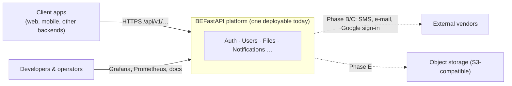
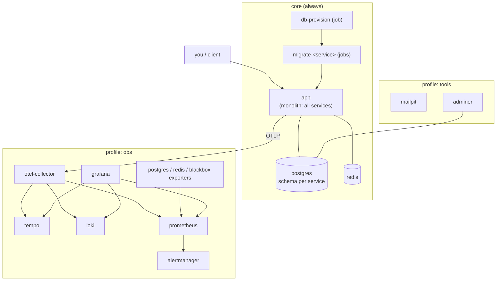
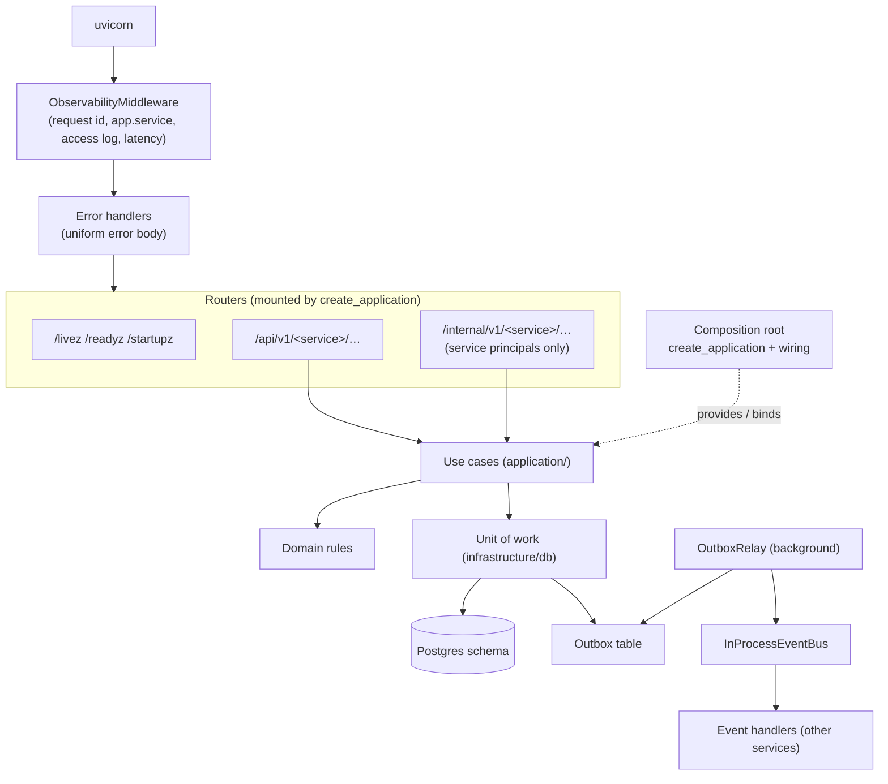
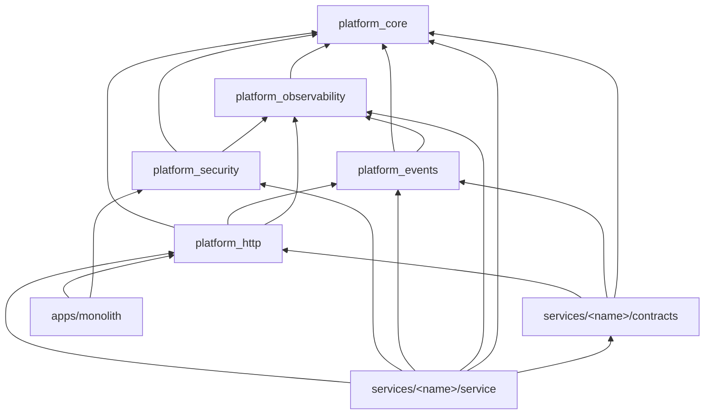
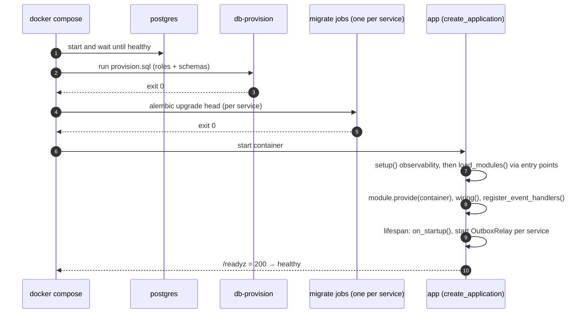
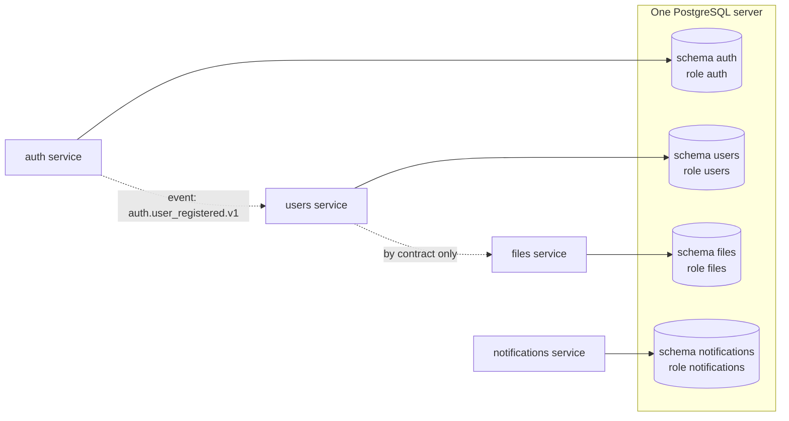
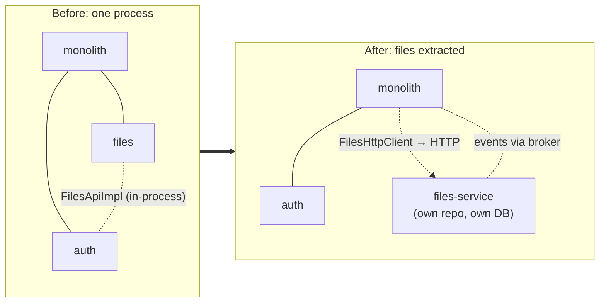
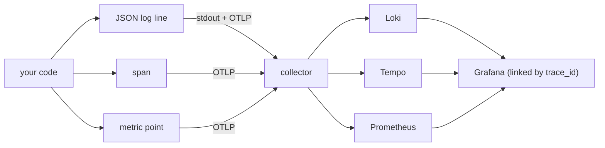
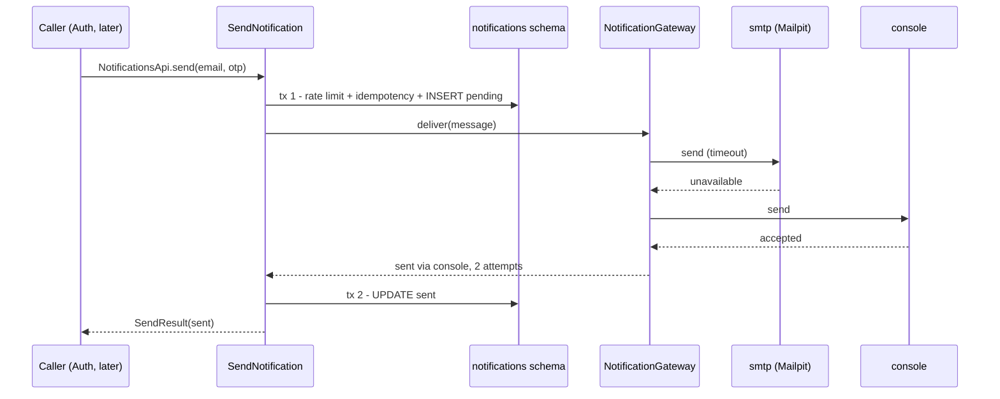

# KT · 04 — Architecture Diagrams

**Goal:** the whole system in pictures, from "who uses it" down to "which library imports which" — the diagrams you'd draw on a whiteboard to explain the project in 15 minutes.
**How to read:** go top-down (context → containers → components → behaviour). Each diagram answers one question. GitHub renders Mermaid; if you can't see them, paste the code into <https://mermaid.live>.

---

## 1. System context — who and what touches us?

*Today only the platform box exists, with the observability stack beside it. Dotted lines are planned.*

## 2. Containers — what actually runs (docker compose)

## 3. Components — inside the monolith process

## 4. Library dependencies — who may import whom

*Arrows point from importer to imported. Libraries never import services (rule B-3); services never import each other (B-1); only `apps/` wires services together (B-4).*

## 5. Start-up sequence

## 6. Who owns which data

*Solid lines are the only data access. Dotted lines are the only cross-service communication: contracts and events. No joins, no foreign keys across schemas.*

## 7. Extraction: before and after

*What changes: one binding in `wiring.py`, the DB URL, and the event bus target. Business code and tests don't change — that is the whole point of the architecture.*

## 8. Where a signal goes (telemetry)

## 9. Sending a notification, with failover

*Two short transactions around the slow provider call; a total failure additionally writes `notifications.delivery_failed.v1` to the outbox in tx 2. See [Phase B](../phase-b/01-notifications-concepts-and-design.md).*

## 🧪 Labs
1. Redraw diagram 5 for the case where `migrate-<service>` fails. What does the app do? What does `docker compose up --wait` print?
2. Add a new box for "Auth" in diagram 3 showing where `JwtVerifier` runs (hint: it's a dependency of the router, not a separate service).
3. Using diagram 4, explain why `platform_core` can't import `platform_events`.

Solutions

1. The app never starts (its `depends_on` condition isn't met); `up --wait` reports the failed dependency container and exits non-zero. 2. In the router layer: `Depends(get_principal)` verifies the bearer token locally before the use case runs. 3. It would create an import cycle (events already depend on core); layering keeps `platform_core` at the bottom.

## 🎯 Interview Questions
1. **Describe the system in two minutes using only diagrams 2, 3 and 6.** *Containers run Postgres/Redis/app plus an optional observability stack; inside the app, requests flow middleware → routers → use cases → unit of work → schema with an outbox relay publishing events; each service owns exactly one schema and talks to others only via contracts and events.*
2. **What changes when you extract a service?** *One wiring binding (to an HTTP client), the database URL, and the event bus target — see diagram 7.*
3. **Why can't libraries import services?** *Dependencies must point inward/downward; a library that knows a service can't be shared by the others and creates cycles.*

## ✅ Self-check
- [ ] I can draw diagrams 2, 3 and 6 from memory.
- [ ] I can explain every arrow's direction in diagram 4.
- [ ] I can narrate diagram 5 including what happens on failure.

**Next:** [KT · 05 — Decision log in plain English →](05-decision-log-in-plain-english.md)
