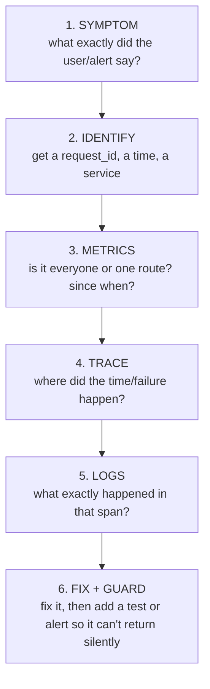

# KT · 06 — Debugging Playbook (with live drills)

**Goal:** a calm, repeatable way to diagnose problems using the tools we built — and five **drills** you can run yourself, each with the real output we captured.
**Prerequisites:** [A2 · 03](../phase-a2/03-the-observability-stack-in-practice.md). **Time:** 1.5 hours for all drills.
Setup for the drills: `cp .env.example .env`, generate a service (`make new-service name=notes`), `APP_PORT=18000 make up`. (Drill 3 also adds a tiny `/slow` endpoint — shown below. Remove everything afterwards: `make down` and delete `services/notes`, `apps/notes_api`, then `make sync`.)

---

## 6.1 The method (the same six steps every time)



| Step | Tool | Question |
|---|---|---|
| Symptom | alert text, user report, error body | *What is broken, for whom, since when?* |
| Identify | the **`request_id`** in every error body and `X-Request-ID` header | *Which exact request?* |
| Metrics | Grafana → **RED overview** (pick the service) | *Rate? error ratio? latency? which route?* |
| Trace | exemplar diamond / Tempo | *Which step was slow or failed?* |
| Logs | Loki: `{service_name=~".+"} \|= "<request-id>"` | *What did the code say about it?* |
| Fix + guard | test, alert, runbook | *How do we notice next time?* |

> 💡 **Learning Thought — start wide (metrics), end narrow (logs).** Starting from a log line tells you about *one* request; starting from the metric tells you whether it's one request or a thousand.

### Triage cheat-sheet: symptom → first command
| Symptom | First look |
|---|---|
| `/readyz` red / probe alert | `curl -i localhost:<port>/readyz` → which module/check is `down`, with `detail` |
| Users see 500 | take the `request_id` from the body → Loki → trace |
| "It's slow" | RED overview → p95 by route → exemplar → trace → which span is long |
| No data on a dashboard | [troubleshooting #23](../troubleshooting.md): traffic? metric name? label? |
| Events not arriving | outbox rows: `select … from <schema>.outbox` (pending vs `failed_at`) + app log `outbox_relay_*` |
| Container won't start | `docker compose ps -a`, `docker compose logs <svc>` (job exited non-zero?) |

---

## Drill 1 — "The database disappears" (readiness, errors, alerts)

▶ **Do it**
```bash
docker compose stop postgres
curl -i localhost:18000/readyz
curl -i localhost:18000/livez
curl -i -H "X-Request-ID: drill-pgdown-0002" localhost:18000/api/v1/notes/ping
```
Real output:
```
/readyz  → HTTP/1.1 503 Service Unavailable
{"status":"down","modules":[{"service":"notes","status":"down","checks":[{"name":"database","status":"down","detail":"gaierror"}]}]}
/livez   → {"status":"ok"}                                   ← the process is fine; only a dependency is gone

ping     → HTTP/1.1 500 Internal Server Error
x-request-id: drill-pgdown-0002
{"error":{"code":"INTERNAL_ERROR","message":"An unexpected error occurred.","details":{},"request_id":"drill-pgdown-0002"}}
```
Read it: **liveness vs readiness** (restart the process? no — stop sending it traffic). `detail: gaierror` = "name not known": Postgres' container is gone, so even the *name* doesn't resolve. The 500 hides internals from the user but gives them a **request id to quote**.

**Find that request in the logs** (by id):
```
event=unhandled_exception   severity=ERROR  trace_id=a7fde2ec…   exception: socket.gaierror: [Errno -2] Name or service not known
event=http_request_completed severity=INFO  http.response.status_code=500  trace_id=a7fde2ec…
```
**…and in the trace:** root span `GET /api/v1/notes/ping` has `status: ERROR`, `http.response.status_code: 500`.

**What fires (wait ~80 s):**
```
ReadyzProbeFailing      state=firing   severity=page   (the blackbox probe sees /readyz failing from the outside)
Alertmanager received:  ReadyzProbeFailing  status=active
probe_success = 0
```
**Recover:** `docker compose start postgres` → `/readyz` returns 200 after ~4 s, **0 container restarts**; the background relay logs `outbox_relay_recovered after_failures=6`.

> ⚠️ **Two real bugs this drill found (both fixed, both have regression tests):**
> 1. The 500 body used to say `"request_id": null`. Starlette's own 500 handler runs *outside* all user middleware, after our middleware had cleared the id. Now `UnhandledErrorMiddleware` sits *inside* the observability middleware, logs `unhandled_exception` with the ids, and answers with the id filled in.
> 2. While the DB was down the outbox relay logged a full traceback **every 0.5 s** (40 lines per 20 s). It now backs off (1 → 2 → … capped at 30 s), logs one traceback then short `outbox_relay_still_failing` reminders (**2 lines per 20 s**), and logs `outbox_relay_recovered` when it heals.
>
> 💡 **Learning Thought — failure paths are products too.** Nobody tests "what do the logs look like when the database is gone" until an outage. Rehearsing it found two defects.

## Drill 2 — "It's slow" (metrics → exemplar → trace)

Add a deliberately slow endpoint to your scratch service (not committed):
```python
# application/services/slow.py                       # api/v1/router.py
class Slow:                                           @router.get("/slow")
    @traced_use_case                                  async def slow(use_case: SlowUseCase, ms: int = 800):
    async def __call__(self, ms: int) -> int:             return {"slept_ms": await use_case(ms)}
        await asyncio.sleep(ms / 1000); return ms
```
▶ **Do it:** call `/api/v1/notes/slow?ms=700` six times and `/ping` 25 times, wait ~25 s, then:

**1. Metrics — which route?**
```
histogram_quantile(0.95, sum by (le, http_route) (rate(http_server_request_duration_seconds_bucket{app_service="notes"}[5m])))
  /api/v1/notes/ping   p95 = 10 ms
  /api/v1/notes/slow   p95 = 975 ms
```
(Why 975 ms and not 700? The histogram only knows "between 0.5 s and 1 s"; Prometheus **interpolates** inside the bucket. Percentiles from histograms are *estimates* whose precision is set by the bucket boundaries.)

**2. Exemplars — a concrete slow request**
```
exemplars on the slow route: [0.702 s, 0.052 s]   → take the largest: trace_id fd3c9570…
```
**3. Trace — where did the time go?**
```
GET /api/v1/notes/slow            702.5 ms
  fastapi.dependencies              0.3 ms
  fastapi.endpoint                701.7 ms
    notes.Slow                      701.6 ms      ← all the time is in OUR use case, not in the framework
  fastapi.serialization             0.0 ms
```
**4. Logs agree:** `http_request_completed … duration_ms: 702.71 … request_id: drill-slow-0001`.

**5. And an alert fired by itself.** With a 0.5 s latency SLO and six 700 ms requests, the generated rule fired within minutes:
```
NotesLatencyBudgetBurn  firing   page    "notes latency SLO is burning 14.4x faster than allowed (1h/5m)"
NotesLatencyBudgetBurn  pending  page    "… 6.0x … (6h/30m)"          NotesLatencyBudgetBurn  pending  ticket  "… 1.0x … (3d/6h)"
Alertmanager: NotesLatencyBudgetBurn status=active
```
Its annotation points to `services/notes/observability/runbook.md#notes-latency-burn` — the runbook you'd now follow.

## Drill 3 — "My event never arrived" (outbox, retries, dead letters)

No Docker needed: a handler that always fails, `max_attempts=3`.
```python
bus.subscribe("shop.order_placed.v1", flaky_handler, name="send_confirmation_email")   # raises RuntimeError("email provider returned 500")
await outbox.add(OrderPlaced(order_id=42))
relay = OutboxRelay("shop", outbox, bus, max_attempts=3)
for attempt in range(1, 5): stats = await relay.run_once()
```
Real output:
```
run 1: published=0 failed=1 dead=0 | attempts=1 failed_at=None
run 2: published=0 failed=1 dead=0 | attempts=2 failed_at=None
run 3: published=0 failed=0 dead=1 | attempts=3 failed_at=set  last_error='EventDeliveryError: 1 handler(s) failed: send_confirmation_email: RuntimeError: email provider returned 500'
run 4: published=0 failed=0 dead=0 | attempts=3 failed_at=set          ← dead-lettered rows are skipped
handler was called 3 times;  pending rows: 0
```
**In production, find them with SQL:**
```sql
select event_name, attempts, last_error, created_at from <schema>.outbox where failed_at is not null order by created_at;   -- dead letters
select count(*) from <schema>.outbox where published_at is null and failed_at is null;                                     -- backlog
```
**Fix the cause, then replay:** `update <schema>.outbox set failed_at = null, attempts = 0 where id = '<id>';` — the relay picks it up again (handlers are idempotent, so a replay is safe).

> 💡 **Learning Thought — a dead letter is a to-do item with the reason attached.** We improved `last_error` so it names the *underlying* error ("email provider returned 500"), not just "1 handler failed" — the first version of this drill showed that gap.

## Drill 4 — "Where did my telemetry go?" (collector down)

```bash
docker compose stop otel-collector
for i in 1 2 3 4 5; do curl -s -o /dev/null -w "%{http_code} " localhost:18000/api/v1/notes/ping; done
```
```
200 200 200 200 200          readyz: ok   app health: healthy   restarts: 0
stdout JSON logs still written: 10 lines (2 per request)        ← `docker compose logs app` still works
```
Telemetry is **best-effort**: requests keep succeeding; traces/metrics from the outage are lost (logs on stdout are not). `docker compose start otel-collector` heals it. If dashboards go blank, check **Platform health → Collector** panels and `docker compose ps otel-collector`.

## Drill 5 — "Is it the code or the environment?"

| Check | Command | Healthy looks like |
|---|---|---|
| Containers | `docker compose ps -a` | long-running `Up (healthy)`; jobs `Exited (0)` |
| Port clash | `lsof -nP -iTCP:8000 -sTCP:LISTEN` | only Docker's process |
| One job failed | `docker compose logs migrate-notes` | no traceback; then verify the **table exists**, not just exit 0 |
| Schema isolation | connect as the service role, try `create table public.x(i int)` | `permission denied for schema public` |
| Config | `docker compose config \| less` | env vars you expect, resolved from `.env` |
| Disk/memory | `docker system df`, `docker stats --no-stream` | whole stack ≈ 0.5 GB RAM |

## 6.2 Writing a good bug report (and a good fix)

**Report:** symptom · expected vs actual · **request_id / trace_id** · time (with timezone) · service · what you already ruled out.
**Fix PR:** (1) a failing test that reproduces it, (2) the fix, (3) if it was silent, an alert or log line so it can't be silent again, (4) a line in [troubleshooting](../troubleshooting.md) if a newcomer could hit it, (5) mention the rule ID if a standard was involved.

## 🧪 Labs
1. Run Drill 1 and write down the *timeline*: when did `/readyz` go red, when did the alert fire, when did it recover? What explains the delay before the alert?
2. In Drill 2, change the SLO threshold in `slo.yaml` to `1.0`, run `make obs-sync`, reload Prometheus (`docker compose exec prometheus kill -HUP 1`). Does the latency alert still fire for 700 ms requests? Why/why not?
3. Break something *new* on purpose (e.g. set a wrong `NOTES_DATABASE_URL` password in `docker-compose.yml`), predict the symptoms in `/readyz`, logs and the container state, then verify.
<details><summary>Solutions</summary>

1. The alert has `for: 1m` plus the probe interval, so it fires ~1–2 min after the outage starts; this avoids paging on a blip. 2. It stops firing: 700 ms is under a 1 s threshold, so those requests count as "good" — SLOs encode what *you* consider acceptable. 3. Typically `/readyz` shows `database: down` with an authentication error class as `detail`, the app container may stay healthy-then-unhealthy, and the migration job (if it uses the same URL) exits non-zero.
</details>

## 🎯 Interview Questions
1. **A user says "I got an error at 14:03". What do you ask for first and why?** *The `request_id` from the error body (or header) — it links the log, the trace and the metric for that exact request; without it you're searching by time and guessing.*
2. **Liveness vs readiness?** *Liveness: is the process alive (restart if not). Readiness: can it serve traffic now (remove from rotation if not). A down database should fail readiness, not liveness.*
3. **How do you tell whether a latency problem is the code, the database, or another service?** *Open a slow trace: the longest span names the culprit (use-case span = our code, DB span = database, client span = another service).*
4. **What should happen to a message that keeps failing?** *Bounded retries, then a dead-letter state with the error recorded, an alert/dashboard on the count, and a safe replay procedure.*
5. **Why is "telemetry is best-effort" acceptable?** *Losing observability data is cheaper than failing customer requests; critical data (logs) also goes to stdout, and we alert on the collector dropping data.*

## ✅ Self-check
- [ ] I can run the six-step method from a request id to a root cause.
- [ ] I ran at least Drills 1 and 2 and saw the alerts fire.
- [ ] I can explain why the relay now backs off and why the 500 body needed the request id.
- [ ] I know the SQL to find and replay dead letters.

## 📚 Further reading
- Google SRE Book — *Effective Troubleshooting*: <https://sre.google/sre-book/effective-troubleshooting/>
- Kubernetes — liveness, readiness and startup probes: <https://kubernetes.io/docs/tasks/configure-pod-container/configure-liveness-readiness-startup-probes/>
- Prometheus — *Histograms and summaries* (why percentiles are estimates): <https://prometheus.io/docs/practices/histograms/>
- Grafana — Exemplars: <https://grafana.com/docs/grafana/latest/fundamentals/exemplars/>

**Next:** [KT · 07 — Roadmap and pre-reading →](07-roadmap-and-prereading.md)
