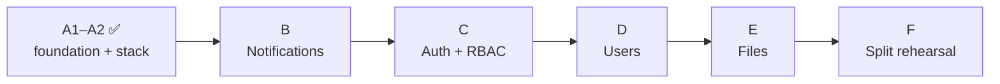

# KT · 07 — Roadmap and Pre-Reading

**Goal:** know what is coming next, and what to read *before* each phase so the chapters make sense on first read.
**Prerequisites:** the Phase A chapters. **Time:** reference.

> Phases A1 and A2 (foundation, local environment, observability) are **done**. The remaining phases build the real services in dependency order (leaves first).

| Phase | What gets built | Concepts you'll meet | Pre-read (short) |
|---|---|---|---|
| **B · Notifications v0** | A vendor-neutral gateway that sends messages (SMS/e-mail/…), a static/console sender for tests, delivery log | Adapter/facade in anger, provider failover, templates, message delivery states | Strategy + Adapter in the [patterns catalogue](03-design-patterns-catalog.md); [OTP basics (RFC 4226 / 6238 overview)](https://datatracker.ietf.org/doc/html/rfc6238) |
| **C · Auth + RBAC** | Sign-up/login by password, OTP and Google; JWT/JWKS issue + verify; refresh rotation; lockout; organisations and roles | Password hashing, token design, brute-force defence, RBAC, multi-tenancy | [OWASP Password Storage](https://cheatsheetseries.owasp.org/cheatsheets/Password_Storage_Cheat_Sheet.html), [JWT introduction](https://jwt.io/introduction), [OAuth 2.0 simplified](https://www.oauth.com/), [OWASP Authentication](https://cheatsheetseries.owasp.org/cheatsheets/Authentication_Cheat_Sheet.html) |
| **D · Users** | Profile service reacting to `auth.user_registered.v1`; batch profile lookups | Event-driven read models, eventual consistency, idempotent handlers | Fowler: [Event-Carried State Transfer](https://martinfowler.com/articles/201701-event-driven.html); revisit [A1 · 05 §5.3](../phase-a1/05-a-request-end-to-end.md) |
| **E · Files** | Upload sessions, signed URLs, storage port (local/S3) | Pre-signed URLs, streaming vs buffering, content types and limits | [Presigned URLs (S3 docs)](https://docs.aws.amazon.com/AmazonS3/latest/userguide/using-presigned-url.html); [OWASP File Upload](https://cheatsheetseries.owasp.org/cheatsheets/File_Upload_Cheat_Sheet.html) |
| **F · Split rehearsal** | Compose `split` profile: separate containers, broker, gateway; run the extraction drill on a service | Strangler fig migration, API gateways, service-to-service auth, message brokers | Fowler: [Strangler Fig](https://martinfowler.com/bliki/StranglerFigApplication.html); the [extraction playbook](../../architecture/EXTRACTION_PLAYBOOK.md) |

## What each new phase will add to this guide
Every phase ships (rule: documentation is part of Definition of Done):
- a **chapter folder** `docs/learning/phase-<id>/` in the same format (concept → code → ▶ real output → ⚠️ traps → 🧪 labs → 🎯 questions → ✅ self-check → 📚 links);
- new entries in the **glossary**, **cheat-sheet**, **troubleshooting**, **codebase map** and **question bank**;
- a refreshed **skills matrix** if a new skill is exercised.

## Reading ahead: the Auth plan in 10 minutes
Open [`services/auth/docs/PLAN.md`](../../../services/auth/docs/PLAN.md) and read only §1 (goals), §6.2 (login methods), §7 (JWT design) and §8 (RBAC). Then answer: *Why does Auth keep OTP codes but delegate delivery to Notifications?* (Answer in [ARCHITECTURE §14](../../architecture/ARCHITECTURE.md).)

## 🎯 Interview Questions
1. **Why build Notifications before Auth?** *Auth depends on Notifications (to deliver OTPs); build leaves of the dependency graph first so no phase waits on an unbuilt dependency.*
2. **Why does the Users service react to an event instead of calling Auth?** *Decoupling and resilience: Users keeps working if Auth is down, and the event is a fact, not a request.*
3. **What's the purpose of a "split rehearsal" before any real extraction?** *To prove (in staging) that boundaries are real: run a service alone, bind its port to HTTP, move its schema, and measure the effort against the playbook budget.*

## ✅ Self-check
- [ ] I can state the build order and the reason for it.
- [ ] I know what to pre-read before the next phase I'll work on.

**Next:** [KT · 08 — Demo script →](08-demo-script.md)
