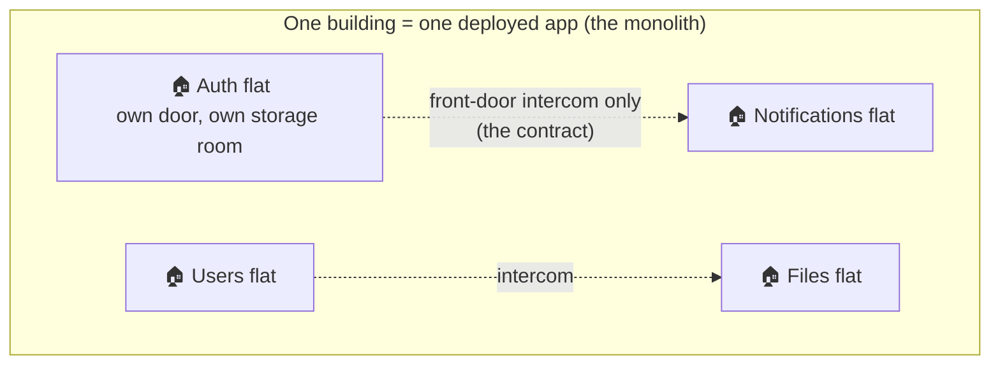

# 01 · The Big Picture

**Goal:** understand *what* we are building, *why* it has this unusual shape, and where everything lives.
**Prerequisites:** basic Python. **Time:** 30 min.

---

## 1.1 The problem we are solving

We need several backend capabilities — **Auth**, **Users**, **Files**, **Notifications** and more. There are two classic ways to build that:

| Style | Picture | Good at | Painful at |
|---|---|---|---|
| **Monolith** | One program; every feature can call every other feature directly | Starting fast, one deploy, easy debugging | Growing: everything slowly becomes tangled, so nothing can be moved or scaled alone |
| **Microservices** | Many small programs talking over a network | Scaling and releasing parts independently | Early on: networks fail, many pipelines, versioned APIs, hard debugging — **a lot of ops cost before you need it** |

We do **not** know yet which parts will get heavy traffic. So we pick a third option.

> 💡 **Learning Thought — design for the exit, not the exit itself.**
> Don't pay for microservices today. Pay a *small, steady* discipline tax so that turning a part into a microservice
> later costs **days, not months**. That discipline tax is this whole project.

### The modular monolith — an apartment-building analogy



- Each **flat** is a *service*. Residents (code) **never walk through each other's walls** (no importing another service's internals).
- The only way in is the **intercom** — the service's small public *contract*.
- Everyone shares the **building** (one process, one database server) so living there is cheap today.
- If Files becomes huge, you can **move that flat into its own house** (its own repo and deployment) because it never relied on the walls.

## 1.2 The one rule

> **Design every service as if it were already remote; deploy them as if they were one process.**

Everything in this codebase is a consequence of that sentence. For example:

| Because of the rule… | …we do this |
|---|---|
| A remote call can fail or be slow | Cross-service calls go through an *adapter* that can later be swapped for HTTP |
| You can't share memory across machines | Services exchange plain data objects (DTOs), never database objects |
| You can't join tables across databases | Each service owns its tables in its own schema; others refer to its data by ID only |
| Remote work is asynchronous | Services announce facts as *events*, written safely through an *outbox* |

## 1.3 The repo map

```
BEFastAPI/
├── apps/                  ← COMPOSITION ROOTS: the only place that knows which services exist and how they connect
│   └── monolith/          ←   runs all services in one process
├── services/              ← one folder == one future repo
│   └── <name>/
│       ├── contracts/     ←   PUBLIC: the intercom (tiny, separately installable)
│       ├── service/       ←   PRIVATE: the implementation (+ migrations + tests)
│       └── observability/ ←   this service's dashboards, alerts, SLOs, runbook
├── libs/                  ← SHARED KERNEL: small, technical, business-free helpers (5 packages)
├── tools/                 ← scripts: service generator, workspace sync, scaffold check
├── docs/                  ← architecture/ (the rules) and learning/ (this guide)
├── pyproject.toml         ← uv workspace root
└── Makefile               ← everyday commands
```

Today `services/` holds only planning docs (`services/auth/docs/PLAN.md`); real services arrive in later phases. Phase A1 built
everything *around* them so that each new service is created by a generator and is correct by construction.

## 1.4 What Phase A1 delivered

| Piece | One-line purpose | Chapter |
|---|---|---|
| uv workspace | Many packages, one environment, one lockfile | [02](02-monorepo-and-uv.md) |
| Architecture checks | A tool that fails the build if someone breaks a boundary | [03](03-boundaries-contracts-and-layers.md) |
| 5 platform libraries | The common plumbing (errors, IDs, DI, events, JWT, logging…) | [04](04-platform-libraries-tour.md) |
| Monolith + app factory | Discovers services and assembles the web app | [05](05-a-request-end-to-end.md) |
| Observability | Logs, metrics, traces that link together | [06](06-observability-for-beginners.md) |
| Service generator | `new_service.py` stamps out a correct service in seconds | [07](07-adding-a-service-hands-on.md) |
| Quality gates + CI | ruff, mypy, import-linter, tests, scaffold check | [08](08-quality-gates-and-ci.md) |

## 1.5 When *would* we split a service out?

Not by default. Only with evidence: it needs to scale independently, it must be isolated for faults/compliance, a separate
team owns it, or its runtime needs differ. See the [extraction playbook](../../architecture/EXTRACTION_PLAYBOOK.md).

> ⚠️ **Trap — "microservices are more professional."** Splitting early multiplies failure modes (timeouts, retries, versioning,
> data consistency) without a benefit. A well-factored modular monolith is a valid *end state*, not a stepping stone you apologise for.

## 🎯 Interview Questions

1. **What is a modular monolith and why choose it over microservices at the start?**
   *One deployable unit organised into modules with enforced boundaries. You get the simplicity of one deploy/debug loop while keeping
   the option to extract hot modules later. Early microservices front-load operational cost (networking, versioning, observability) before
   there is evidence you need independent scaling.*
2. **What makes extraction cheap here?** *Services only talk through contracts, own their data (schema, migrations, config), and are wired
   together in one place (the composition root). Extraction becomes: move the folder, change one binding to an HTTP client, move one schema.*
3. **What is a "distributed monolith" and how do we avoid it?** *Services that can't work without each other synchronously.
   We avoid it with ≤ 1 hop for calls, events + local read-models for data we need often, and no shared tables.*
4. **Why not simply use separate folders with a convention?** *Conventions rot. We enforce boundaries with tooling (import-linter,
   per-service test runs) so a violation fails CI.*

## ✅ Self-check
- [ ] I can explain the apartment analogy in one minute without notes.
- [ ] I can state "the one rule" and give two consequences of it.
- [ ] I can point to where a service's public part and private part live.
- [ ] I know why `apps/` is the only folder allowed to know about several services.

## 📚 Further reading
- Martin Fowler — *MonolithFirst*: <https://martinfowler.com/bliki/MonolithFirst.html>
- Martin Fowler & James Lewis — *Microservices*: <https://martinfowler.com/articles/microservices.html>
- The Twelve-Factor App: <https://12factor.net/>

**Next:** [02 · Monorepo & uv →](02-monorepo-and-uv.md)
