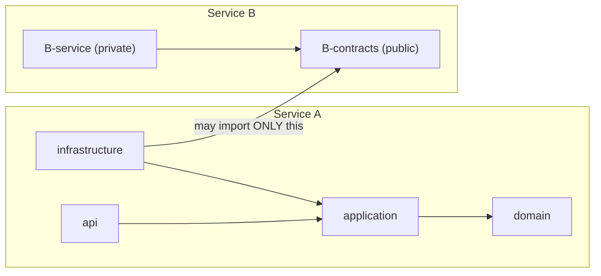
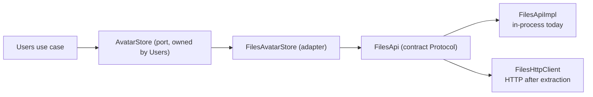
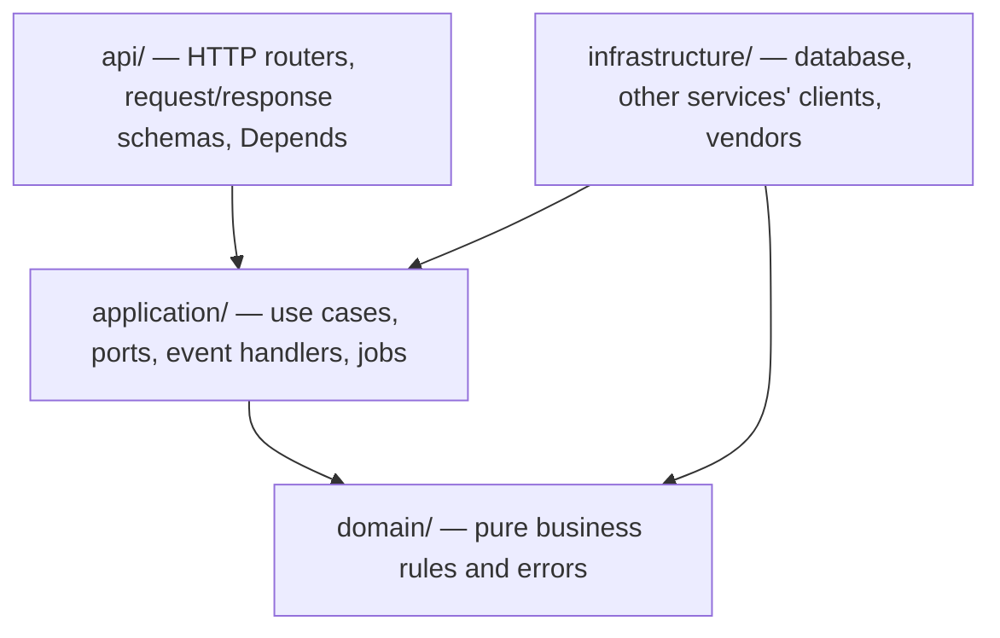

# 03 · Boundaries, Contracts & Layers

**Goal:** learn the three ideas that make extraction cheap — *contracts*, *ports & adapters*, *layers* — and see a tool **enforce** them.
**Prerequisites:** chapters 01–02. **Time:** 1 hour.

---

## 3.1 Two kinds of boundary



1. **Between services** — A may use B only through `B-contracts` (rule **B-1**).
2. **Inside a service** — code is layered; imports only flow one way (rules **L-1…L-3**).

## 3.2 What is a contract?

A contract is the **intercom** from chapter 01. For a service called `files` it is the package `files_contracts` containing:

| File | Holds | Why |
|---|---|---|
| `api.py` | A `Protocol` listing what others may ask ("get a signed URL") | The *question* |
| `dto.py` | Pydantic data classes passed in/out | The *shape of the answer*; never a DB object |
| `events.py` | Versioned events (`files.file_uploaded.v1`) | Facts others may react to |
| `errors.py` | Contract-level errors (`FilesUnavailable`) | So callers handle failure the same way in-process and over HTTP |
| `http_client.py` | An HTTP implementation of `api.py` | Used **after** extraction |

The generated sample (see chapter 07) is tiny on purpose:

```python
# services/<name>/contracts/src/<name>_contracts/api.py
class NotesApi(Protocol):
    async def ping(self) -> PingResult: ...
```

> 💡 **Learning Thought — a `Protocol` is a promise without a class.** Any object with an `async def ping(self) -> PingResult`
> satisfies `NotesApi`. That is how an in-process object and an HTTP client can be *interchangeable* without inheriting from anything.

## 3.3 Ports & adapters (the swap that makes extraction a one-line change)

**Problem:** the Users service needs an avatar URL from Files. If Users imported Files' code, they'd be welded together.

**Solution:** Users declares what *it* needs, in *its* words (a **port**). A small **adapter** translates to Files' contract.

```python
# users/…/application/ports.py        ← Users' own vocabulary (it owns this interface)
class AvatarStore(Protocol):
    async def get_avatar_url(self, file_id: UUID) -> str | None: ...

# users/…/infrastructure/clients/files_avatar_store.py     ← the ONLY place that imports files_contracts
class FilesAvatarStore:
    def __init__(self, files: FilesApi) -> None: self._files = files
    async def get_avatar_url(self, file_id: UUID) -> str | None:
        try:
            return (await self._files.get_signed_url(file_id, ttl_s=300)).url
        except FileNotFound:
            return None
```

Who supplies `files: FilesApi`? **The composition root** (`apps/monolith/.../wiring.py`):

```python
# today (same process)
container.bind(FilesApi, FilesApiImpl(...))
# after extraction — the ONLY line that changes
container.bind(FilesApi, FilesHttpClient(ServiceHttpClient("http://files:8000", target="files")), override=True)
```



> 💡 **Learning Thought — dependency inversion in one sentence.** The *consumer* defines the interface; the *provider* adapts to it.
> Business code never knows whether the other side is a function call or a network hop.

## 3.4 Layers inside a service


An arrow means "is allowed to import". Anything not drawn is **forbidden**:

| Layer | Knows about | Must never import |
|---|---|---|
| `domain` | itself | FastAPI, SQLAlchemy, httpx, Redis, `application`, `infrastructure`, `api` |
| `application` | `domain`, its own ports | FastAPI, SQLAlchemy, vendor SDKs, `infrastructure`, `api` |
| `infrastructure` | `application.ports`, `domain`, SQLAlchemy, SDKs, **other services' contracts** | `api`, other services' internals |
| `api` | `application` | `infrastructure` |

### Four different "models" — don't mix them (rule L-5)

| Model | Lives in | Job |
|---|---|---|
| HTTP schema | `api/` | what the REST client sends/receives |
| Domain entity | `domain/` | business meaning |
| ORM model | `infrastructure/db/` | table mapping |
| Contract DTO | `*_contracts` | what crosses to other services |

> ⚠️ **Trap — "one class for everything is simpler."** It is, for a week. Then a column rename breaks the public API and another
> service. Mapping at each seam is boring and cheap; untangling later is neither.

## 3.5 Enforcement: architecture as a failing test

Rules written in a document get ignored. **import-linter** reads every `import` in the codebase and fails if a rule is broken.
The configuration (`.importlinter`) is *generated* from the services on disk, so new services are covered automatically.

▶ **Try it** — break a rule on purpose (undo it afterwards!):

```bash
# 1. as a beginner mistake: import FastAPI inside the domain layer
printf '\nimport fastapi\n' >> services/notes/service/src/notes_service/domain/errors.py
uv run lint-imports
```
Real output (captured from this repo; the sample service was named `demo` at the time, so the lines say `demo_service` — yours will show your service's name):
```
B-3/B-4: services never import composition roots KEPT
B-2: contracts never directly import frameworks or implementations KEPT
B-3: libs never import services, contracts or apps KEPT
L-1: demo_service layering (api|infrastructure > application > domain) KEPT
L-2/L-3: demo_service domain and application never directly import frameworks or
vendors BROKEN

Contracts: 4 kept, 1 broken.
```
Another real one — `application` reaching into `infrastructure`:
```
L-1: demo_service layering (api|infrastructure > application > domain) BROKEN
demo_service.application is not allowed to import demo_service.infrastructure:
- demo_service.application.ports -> demo_service.infrastructure.db.models (l.23)
```

> 💡 **Learning Thought — the build is the reviewer that never gets tired.** A boundary that CI enforces survives staff changes,
> deadlines and "just this once".

## 3.6 The anti-patterns, in plain English

| Anti-pattern (ID) | What it looks like | Why it hurts |
|---|---|---|
| Deep import (AP-01) | `from auth_service.infrastructure.db import User` in another service | Welds the services; extraction breaks every importer |
| Shared database access (AP-02) | Service B queries service A's table | A can never change or move its tables |
| `utils/` dumping ground (AP-04) | Everything shared goes to one `common` package | Hidden coupling; every change ripples |
| Business logic in routers (AP-06) | `if user.is_locked: …` inside a route | Can't reuse from jobs/handlers; untestable |
| Chatty calls (AP-09) | `for id in ids: get_user(id)` across services | Cheap in-process, disastrous over a network |

All 33 are in [STANDARDS §7](../../architecture/STANDARDS.md#7-anti-pattern-catalogue).

## 🧪 Lab 3.1 — where does it go?
For each, decide the layer (or "not allowed"): (a) the rule "a locked account cannot log in"; (b) a SQLAlchemy `select()`; (c) a function
that formats an HTTP 404 body; (d) calling Notifications to send an e-mail; (e) the `Depends(get_principal)` helper.
<details><summary>Solution</summary>

(a) `domain` (pure rule) invoked by a use case in `application`. (b) `infrastructure/db`. (c) `api` (actually the shared
`platform_http` error handler). (d) the use case depends on a **port** in `application`; the adapter calling `notifications_contracts` lives in
`infrastructure/clients`. (e) `api/deps.py` — the only layer allowed to use `Depends`.
</details>

## 🎯 Interview Questions
1. **Explain ports and adapters with an example.** *A port is an interface owned by the consumer ("AvatarStore"); an adapter implements it
   by calling something real (another service's contract, a vendor SDK). Business code depends on the port, so the real thing can change
   from in-process to HTTP without touching business code.*
2. **Why must contract DTOs be separate from ORM models?** *The wire format must be stable and independent of table design; ORM objects
   carry lazy-loading and session state that cannot cross a network.*
3. **How do you stop developers from violating architecture?** *Encode rules as automated checks (import-linter in CI), generated
   per service, plus per-service isolated test runs.*
4. **What's the difference between a `Protocol` and an abstract base class?** *A Protocol is structural — anything with matching methods
   conforms, no inheritance needed; ABCs are nominal. Protocols keep the consumer free of the provider's class hierarchy.*

## ✅ Self-check
- [ ] I can list the files of a contracts package and why each exists.
- [ ] I can draw the avatar example (port → adapter → contract → impl/http).
- [ ] I can name which layer may import which, and the four kinds of model.
- [ ] I can run `lint-imports`, break a rule deliberately, and read the failure.

## 📚 Further reading
- Alistair Cockburn — *Hexagonal architecture*: <https://alistair.cockburn.us/hexagonal-architecture/>
- import-linter docs: <https://import-linter.readthedocs.io/>
- Python docs — `typing.Protocol`: <https://docs.python.org/3/library/typing.html#typing.Protocol>

**Next:** [04 · Platform libraries tour →](04-platform-libraries-tour.md)
