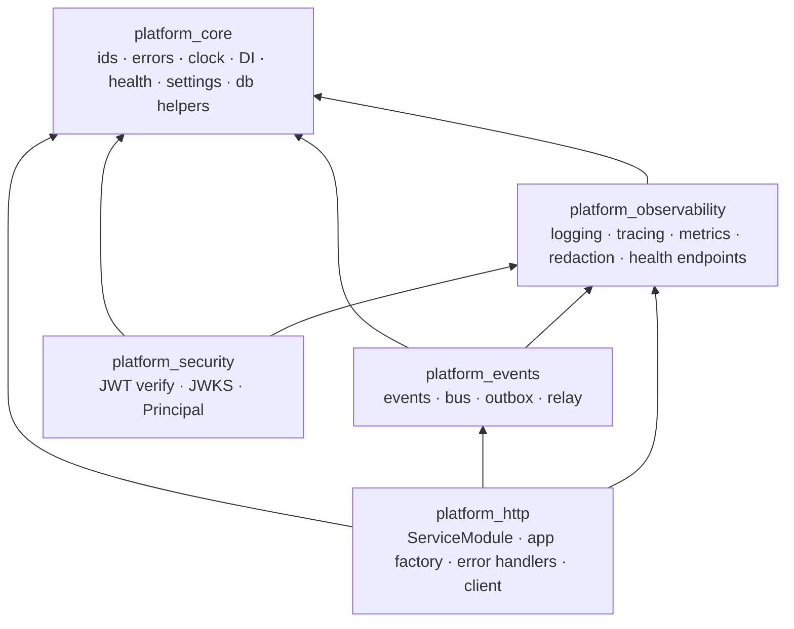

# 04 · Platform Libraries Tour

**Goal:** know what each of the five shared libraries in `libs/` gives you, with small runnable examples.
**Prerequisites:** chapters 01–03. **Time:** 1–1.5 hours.

> **Rule B-8:** `libs/` is *technical and business-free*. No library knows what a "user" or an "invoice" is. If a helper has domain
> vocabulary, it belongs in a service, not here.



---

## 4.1 `platform_core` — the vocabulary everyone shares

### IDs: `uuid7()` (rule D-9)
Why not `uuid4()`? Random UUIDs scatter inserts across a database index. UUIDv7 puts a **timestamp first**, so newer IDs sort later.

▶ **Try it**
```python
from platform_core import uuid7
ids = [uuid7() for _ in range(3)]
print(*ids, sep="\n"); print("sorted == creation order:", ids == sorted(ids))
```
```
01a152a4-b747-76f7-a44f-59cb444c75c4
01a152a4-b747-76f8-8c9a-007cb6c3d0a4
01a152a4-b747-76f9-b2aa-a3a317b650fc
sorted == creation order: True
```
Notice the first block `01a152a4-b747` is the millisecond timestamp, and the next hex group counts up (`76f7`, `76f8`, `76f9`).

> ⚠️ **Trap — "time-ordered" has a catch.** Our first version filled those 12 bits with random numbers, so two IDs in the *same
> millisecond* came out in random order (we printed `sorted == creation order: False`). We fixed it by using the field as a counter
> (RFC 9562 "Method 1") and added a test that generates 20 000 IDs and asserts they are strictly increasing. Writing the doc found the bug.

### Errors: one family, mapped to HTTP only at the edge (rule X-3)
```python
from platform_core.errors import NotFoundError
raise NotFoundError("No such note", code="NOTES_NOT_FOUND")
```
Domain code raises *categories* (`NotFoundError`, `ConflictError`, `UnauthenticatedError`, `RateLimitedError`, `UnavailableError` …). It never
mentions "404". The HTTP layer translates: `NotFoundError → 404`, `ConflictError → 409`, `UnavailableError → 503` …

### Clock (rule D-10) and the DI container
```python
from platform_core import FixedClock, Container
clock = FixedClock(); clock.advance(seconds=30)      # deterministic time in tests

class Greeter(Protocol):
    def greet(self) -> str: ...
container = Container(); container.bind(Greeter, English())
container.resolve(Greeter).greet()                   # 'hello'
```
Never call `datetime.now()` in business code — inject a `Clock`, so tests can freeze and advance time.

> 💡 **Learning Thought — testability is a design outcome.** Anything non-deterministic (time, randomness, network) enters through an
> interface you can replace.

Also here: `HealthReport`, `PlatformSettings`/`ServiceSettings` (env-driven config with per-service prefixes), `make_metadata(schema)` and an async engine
helper (one schema per service), and cursor `Page` types.

## 4.2 `platform_http` — the web edge

| Piece | What it does |
|---|---|
| `ServiceModule` / `BaseServiceModule` | The *single door* every service exposes: routers, `provide()`, event handlers, startup/shutdown, `health()` |
| `create_application(...)` | The app factory: mounts routers, wires the event bus and outbox relays, adds health endpoints, error handlers and middleware |
| `load_modules()` | Finds services through entry points (chapter 02) |
| `install_error_handlers()` | Turns every error into the uniform JSON body |
| `ServiceHttpClient` | Outbound HTTP with timeouts, retries (only when safe), request-id propagation, error mapping |

▶ **Try it** — the uniform error body (captured from a running app):
```
GET /nope  ->  404
{"error": {"code": "NOT_FOUND", "message": "Not Found", "details": {}, "request_id": "01a152a4-6cac-733d-bbe1-9cc1886a33a9"}}
```
The `request_id` is the same one in the server log line — a user can quote it in a bug report and you can find everything that happened.

> ⚠️ **Trap — retrying a POST.** `ServiceHttpClient` retries `GET/PUT/DELETE` automatically (they are idempotent) but retries a `POST`
> **only if you pass an idempotency key**; otherwise a retry could create two orders. See `libs/platform_http/src/platform_http/client.py`.

## 4.3 `platform_events` — facts, delivered safely

Covered in depth in [chapter 05](05-a-request-end-to-end.md). Pieces: `IntegrationEvent` (name must look like `svc.noun_verb.v1`; invalid names fail at *import* time),
`InProcessEventBus`, `InMemoryOutbox`/`SqlOutboxWriter`/`SqlOutboxStore`, `OutboxRelay`, and `idempotent()` handler wrapper.

## 4.4 `platform_security` — who is calling?

Auth (a later phase) *issues* tokens. Every other service only *verifies* them, locally, with the public key. No network call per request (rule **X-1**).

▶ **Try it** — decode a token and turn it into a `Principal` (uses the test helper; `verify` is async, so run it with `asyncio.run`):
```python
import asyncio
from platform_security.testing import TestAuth
auth = TestAuth()
token = auth.token("user-42", org="org-7", roles=["org_admin"], sid="sess-1")
print(repr(asyncio.run(auth.verifier.verify(token))))
```
Real output:
```
header: {'alg': 'RS256', 'kid': 'test-key', 'typ': 'JWT'}
claims: {'iss': 'https://auth.test', 'aud': 'befastapi', 'sub': 'user-42', 'roles': ['org_admin'], 'amr': ['pwd'], 'org': 'org-7', 'sid': 'sess-1'}
Principal(kind=<PrincipalKind.USER: 'user'>, subject='user-42', session_id='sess-1', org_id='org-7', roles=('org_admin',), platform_roles=(), amr=('pwd',), token_id='test-jti')
```
The verifier rejects: expired tokens, wrong audience/issuer, wrong signing key, unknown `kid`, wrong `scope`, malformed strings — and refuses to be built
with the `none` algorithm. See `libs/platform_security/tests/test_security.py` for each case.

FastAPI helpers: `CurrentPrincipal` (dependency), `require_org_roles(...)`, `require_platform_roles(...)`, `require_permission(...)`.

> ⚠️ **Trap — trusting the body.** Never authorize with a `user_id`/`org_id` taken from the request JSON. Take them from the verified
> `Principal` (rule **X-2**). A client can send any value it likes.

## 4.5 `platform_observability` — seeing inside

Detailed in [chapter 06](06-observability-for-beginners.md). The two things to try now:

▶ **Redaction** — secrets never reach logs/spans:
```python
from platform_observability.redaction import redact
redact({"user": "u1", "password": "hunter2", "nested": {"otp_code": "123456", "Authorization": "Bearer abcdefghijkl"}, "note": "card 4111 1111 1111 1111"})
```
```
{"user": "u1", "password": "[REDACTED]", "nested": {"otp_code": "[REDACTED]", "Authorization": "[REDACTED]"}, "note": "card [REDACTED]"}
```
▶ **Masking** — when you need *some* of a value: `mask_email("alice@example.com") → 'a***@example.com'`, `mask_phone("+919876543210") → '+********3210'`.

## 🧪 Lab 4.1
1. Write a one-line expression using `Container` that proves binding the same port twice raises unless you pass `override=True`.
2. Which error class would you raise when another service times out? When a user supplies an invalid date?
3. Why does `uuid7()` use a lock?
<details><summary>Solution</summary>

1. `c.bind(P, a); c.bind(P, b)` → `ValueError`; `c.bind(P, b, override=True)` works. (`libs/platform_core/tests/test_kernel.py`)
2. `DependencyTimeoutError` (an `UnavailableError`, → 504); `InvalidInputError` (→ 422).
3. The monotonic counter is shared state: two threads in one millisecond could otherwise produce the same counter value.
</details>

## 🎯 Interview Questions
1. **Why inject a clock instead of calling `datetime.now()`?** *So time-dependent logic (expiry, lockouts) is deterministic in tests, and so
   production code never hides a dependency on the system clock.*
2. **Why verify JWTs locally with a public key instead of asking the auth service?** *No per-request network hop or single point of
   failure; the signature plus `iss/aud/exp` checks prove authenticity. Key rotation is handled by refetching the JWKS when an unknown `kid` appears.*
3. **Why map errors to HTTP only at the edge?** *Domain code stays framework-free and reusable from jobs/handlers; a different transport
   (gRPC, CLI) can map the same categories differently.*
4. **What is idempotency and where do we rely on it?** *Doing something twice equals doing it once. Event handlers (at-least-once delivery) and
   retried POSTs (with an idempotency key) depend on it.*

## ✅ Self-check
- [ ] I can say what each of the five libs is for in one sentence.
- [ ] I can explain why uuid7 beats uuid4 as a primary key and what the same-millisecond bug was.
- [ ] I know which error class to raise for not-found / conflict / dependency-down.
- [ ] I know why identity comes from the `Principal`, never from the body.

## 📚 Further reading
- RFC 9562 (UUIDv7): <https://www.rfc-editor.org/rfc/rfc9562.html>
- RFC 7519 (JWT): <https://www.rfc-editor.org/rfc/rfc7519>
- RFC 7517 (JWK / JWKS): <https://www.rfc-editor.org/rfc/rfc7517>
- Pydantic docs: <https://docs.pydantic.dev/latest/>

**Next:** [05 · A request, end to end →](05-a-request-end-to-end.md)
