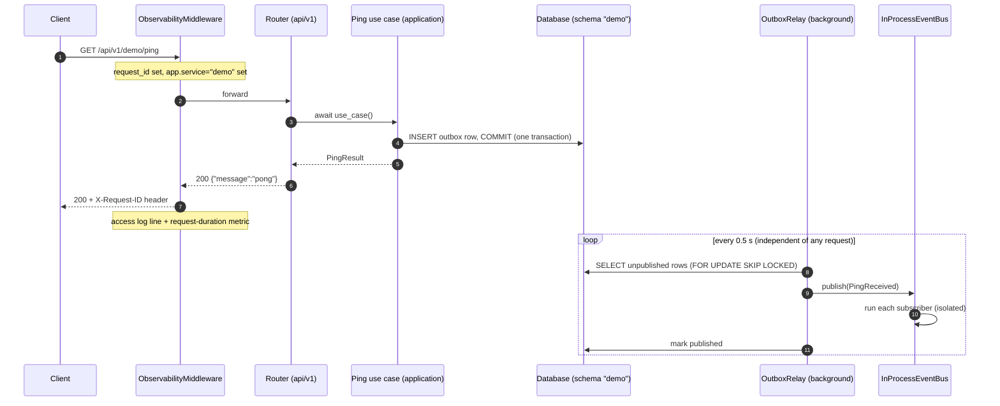

# 05 · A Request, End to End

**Goal:** follow **one** HTTP call through every layer — middleware, router, use case, database transaction, outbox, relay, event bus —
and read the real logs, spans and metrics it produced.
**Prerequisites:** chapters 01–04. **Time:** 1 hour.

We use the sample endpoint that every generated service ships with: `GET /api/v1/<service>/ping`. (Real services replace it; the *pattern* stays.)
All output below was captured from a service generated with the name `demo`.

---

## 5.1 The journey



| Step | Code | What happens |
|---|---|---|
| 1 | [`middleware.py`](../../../libs/platform_observability/src/platform_observability/middleware.py) | Reads/creates `X-Request-ID`; works out `app.service` from the URL (`/api/v1/demo/…` → `demo`); times the request |
| 2 | generated `api/v1/router.py` | Thin: calls the use case, wraps the result in an HTTP schema |
| 3 | generated `application/services/ping.py` | Opens a **unit of work**, adds an event to the outbox, commits, bumps a business metric, logs `ping_handled` |
| 4 | generated `infrastructure/db/uow.py` | One session/transaction; `commit()` writes data **and** outbox row atomically |
| 5 | [`relay.py`](../../../libs/platform_events/src/platform_events/relay.py) | Background loop moves committed rows to the bus |
| 6 | [`bus.py`](../../../libs/platform_events/src/platform_events/bus.py) | Calls every subscriber; one failing subscriber doesn't stop the others |

## 5.2 What we actually saw

▶ **Try it** — response and headers:
```
RESPONSE 200  x-request-id: req-learning-0001
{'service': 'demo', 'message': 'pong', 'at': '2026-10-19T05:30:52.668182Z'}
```

**Logs** (JSON, one per line; shown pretty here). Note the shared `request_id` and `trace_id`:
```json
{"event": "ping_handled", "request_id": "req-learning-0001", "app.service": "demo",
 "trace_id": "7116c0543d43d58b7c08974f1e0401c8", "span_id": "a91d155dfdf32b1d", "severity": "INFO", ...}
{"event": "http_request_completed", "http.request.method": "GET", "http.route": "/api/v1/demo/ping",
 "http.response.status_code": 200, "duration_ms": 29.22, "request_id": "req-learning-0001", "app.service": "demo",
 "trace_id": "7116c0543d43d58b7c08974f1e0401c8", ...}
```

**Spans** (the timed steps of the story):
```
GET /api/v1/demo/ping                 kind=SERVER    app.service=demo   (root)
 ├─ fastapi.dependencies              kind=INTERNAL
 ├─ fastapi.endpoint                  kind=INTERNAL
 │   └─ demo.Ping                     kind=INTERNAL                    ← our use-case span
 └─ fastapi.serialization             kind=INTERNAL
events.publish demo.ping_received.v1  kind=PRODUCER  app.service=demo   (a SEPARATE root — see below)
 └─ events.handle demo.ping_received.v1  kind=INTERNAL
```

**Metrics**:
```
http.server.request.duration  {http.request.method: GET, http.route: /api/v1/demo/ping, status: 200, app.service: demo}
demo.ping.received            {outcome: ok, app.service: demo}
```

**The event** reached a subscriber:
```
EVENT_RECEIVED {'event_id': '01a152a4-297a-7e01-9a54-1f37ebaf57dd', 'occurred_at': '2026-10-19T05:30:52.666270Z', 'correlation_id': None, 'message': 'pong'}
```

> 💡 **Learning Thought — why is `events.publish` a separate root trace?** The HTTP request finished long before the relay published.
> Async work is *linked* to the cause (a span link carries the original `traceparent` stored on the outbox row) instead of being
> falsely shown as part of the request. Same reason you don't staple a delivery receipt to the order form after the parcel has shipped.

## 5.3 The transactional outbox — the most important pattern in this chapter

**The bug it prevents.** Naive code does two things: (1) save to the database, (2) publish an event. If the process crashes between them
you get **saved but never announced** (or announced but not saved if you swap the order).

**The fix.** Make it *one* thing: write the event into an `outbox` table in the **same transaction** as your data. A relay publishes later.

▶ **Try it** — the row right after the request, before the relay ran:
```
{'id': '01a152a4-6ca7-734e-8c34-2530a81bdf9b', 'event_name': 'demo.ping_received.v1',
 'payload': "{'event_id': '01a1…', 'message': 'pong', ...}", 'traceparent': None,
 'published_at': None, 'attempts': '0', 'failed_at': None, 'last_error': None}
```
(`traceparent` is `None` here only because telemetry was switched off for this probe; with tracing on it holds the request's trace id.)

| Failure | What happens | Why it's safe |
|---|---|---|
| Crash after commit, before publish | Row is still `published_at IS NULL`; relay publishes on restart | The event was committed with the data |
| Subscriber raises | Relay records `attempts+1`, `last_error`; retries next loop | Handlers are idempotent |
| Keeps failing | After `max_attempts` (default 10) row gets `failed_at` → **dead-lettered**, error logged | Poison messages don't block the queue |
| Two relays running | `FOR UPDATE SKIP LOCKED` — each claims different rows | No double-claim (ignored on SQLite) |
| Same event delivered twice | `idempotent(...)` wrapper skips an already-processed `event_id` | At-least-once delivery is the norm |

> ⚠️ **Trap — "exactly once" is a myth over a network.** You get *at least once* delivery and make handlers idempotent. Designing for
> duplicates is simpler and safer than hoping for none.

> 💡 **Learning Thought — the relay is the only part that changes at extraction.** Today it publishes to an in-process bus. Later the
> same rows can be published to Redis Streams/Kafka. Producers and handlers don't change.

## 5.4 How the app is assembled

`create_application` ([`compose.py`](../../../libs/platform_http/src/platform_http/compose.py)) does, in order:
1. `module.provide(container)` — each service binds its contract implementations.
2. `wiring(container, modules)` — `apps/*` binds cross-service ports (none yet).
3. `module.register_event_handlers(bus)` — services subscribe.
4. Mounts routers (after `validate_router_prefix`: `/api/v1/<name>/…` or `/internal/v1/<name>/…`), health endpoints, error handlers, middleware.
5. On start-up (`lifespan`): `module.on_startup(...)` and starts an `OutboxRelay` for each service that has an outbox. On shutdown: stops relays (final flush), shuts modules down in reverse order, flushes telemetry.

▶ **Try it** — health endpoints on a running monolith:
```
GET /livez    -> 200 {"status":"ok"}
GET /startupz -> 200 {"status":"ok"}
GET /readyz   -> 200 {"status":"ok","modules":[{"service":"demo","status":"ok","checks":[{"name":"database","status":"ok","detail":null}]}]}
```
`/livez` = "process is alive", `/readyz` = "can serve traffic" (aggregates every enabled service's own health check), `/startupz` = "finished booting".

## 🧪 Lab 5.1 — follow your own request
Once you have a generated service (chapter 07): run the monolith, call `/api/v1/<name>/ping` with `-H 'X-Request-ID: my-first-request'`, then find the
two log lines for it. Which fields let you jump from the log to the trace?
<details><summary>Solution</summary>

`request_id` is the same on both lines; `trace_id` + `span_id` locate the trace in the tracing backend (Phase A2 gives you Grafana/Tempo).
`app.service` tells you which logical service handled it even though everything runs in one process.
</details>

## 🎯 Interview Questions
1. **What problem does the transactional outbox solve?** *The dual-write problem — updating the database and publishing a message are two
   operations that can't be atomic. The outbox makes the message part of the database transaction; a relay publishes it afterwards.*
2. **What delivery guarantee do we have and what does it demand of consumers?** *At-least-once; consumers must be idempotent.*
3. **Why store `traceparent` on the outbox row?** *So the asynchronous publish/handle spans can link back to the request that caused them.*
4. **What is a dead-letter state and why have one?** *A parked message after repeated failures, so one poison message can't block the stream and a human can inspect it.*
5. **Why is `readyz` different from `livez`?** *Liveness restarts a stuck process; readiness only removes it from rotation until dependencies (DB, etc.) are healthy.*

## ✅ Self-check
- [ ] I can narrate the sequence diagram from memory.
- [ ] I can explain why the event row and the data commit together.
- [ ] I can list three failure cases and what the outbox does in each.
- [ ] I know why the publish span is a separate trace root.

## 📚 Further reading
- Chris Richardson — *Transactional outbox*: <https://microservices.io/patterns/data/transactional-outbox.html>
- OpenTelemetry — *Traces* (spans, links): <https://opentelemetry.io/docs/concepts/signals/traces/>
- Google SRE Book — *Monitoring Distributed Systems*: <https://sre.google/sre-book/monitoring-distributed-systems/>

**Next:** [06 · Observability for beginners →](06-observability-for-beginners.md)
