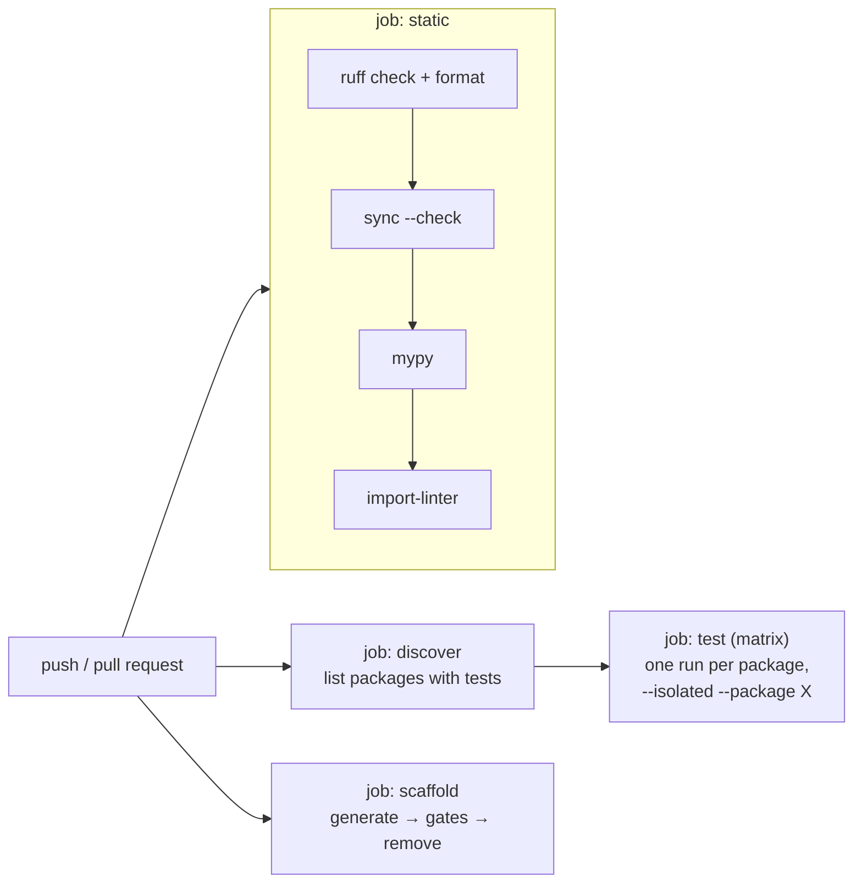

# 08 · Quality Gates & CI

**Goal:** know what each automated check does, how to run it, how to read its failures, and how CI strings them together.
**Prerequisites:** chapter 07. **Time:** 45 min.

> **A gate** is an automated check that must pass before code merges. We have five kinds. Together they turn the architecture rules from
> "please remember" into "the build fails".

| Gate | Tool | Question it answers | Command |
|---|---|---|---|
| Style & bug patterns | **ruff** (`check` + `format`) | Is this tidy and free of common mistakes? | `make lint` |
| Types | **mypy `--strict`** | Do the types line up? | `make typecheck` |
| Architecture | **import-linter** | Does any import cross a forbidden boundary? | `uv run lint-imports` |
| Behaviour | **pytest** | Does it work? | `make test` |
| Generated files | `sync_workspace.py --check` | Are generated files up to date? | included in `make lint` |
| Template health | `scaffold_check.sh` | Does a freshly generated service still pass everything? | `make scaffold-check` |

---

## 8.1 Ruff — linter and formatter in one

▶ **Try it**
```bash
uv run ruff check .            # find problems
uv run ruff check . --fix      # auto-fix the safe ones
uv run ruff format .           # reformat (like Black)
```
Rules we enabled (see `[tool.ruff.lint]` in `pyproject.toml`) and a one-line reason each:

| Rule family | Catches |
|---|---|
| `E`,`W`,`F`,`I` | basic errors, unused imports, **import order** |
| `B`,`SIM`,`C4`,`UP`,`RUF` | likely bugs, simplifications, modern syntax |
| `ASYNC` | blocking calls inside `async def` |
| `S` (bandit) | security smells (hard-coded passwords, `eval`) |
| `T20` | `print()` — we log with the structured logger instead (rule O-2) |
| `TID` | **relative imports banned**, vendor telemetry SDKs banned (O-1) |
| `ANN` | missing type annotations |
| `BLE` | blind `except Exception` — allowed only with a `# noqa: BLE001 - reason` |

Real findings we had to fix while building Phase A1:

| Code | Message | Meaning / fix |
|---|---|---|
| `I001` | Import block is un-sorted | run `ruff check --fix` |
| `RUF100` | Unused `noqa` directive | the suppression is no longer needed — delete it |
| `PT018` | Assertion should be broken down | `assert a and b` → two asserts (better failure messages) |
| `UP047` | Generic function should use type parameters | use `def f[**P, R](...)` (Python 3.12 syntax) |
| `B008` | Function call in argument defaults | FastAPI's `Depends(...)` is the classic false alarm; configured as allowed |

> 💡 **Learning Thought — configure the tool once, then trust it.** We listed `Depends`, `Query`, `Header` as *immutable calls* so `B008` stays useful
> instead of being sprinkled with `# noqa`.

## 8.2 mypy — the type checker

`strict = true` means: every function annotated, no implicit `Any`, no ignoring missing return types. We run it **per package** with `-p`:

▶ **Try it**
```bash
make typecheck
# Success: no issues found in 40 source files
```

### A real error worth understanding
```
module.py:38: error: Argument "uow_factory" to "Ping" has incompatible type "Callable[[], SqlUnitOfWork]"; expected "Callable[[], UnitOfWork]"
module.py:38: note:     outbox: expected "OutboxWriter", got "SqlOutboxWriter"
```
The `UnitOfWork` Protocol declared `outbox: OutboxWriter` — a **mutable** attribute. A mutable attribute is *invariant*: if the protocol allows you to *assign* any `OutboxWriter` to it,
then an implementation whose attribute is only `SqlOutboxWriter` isn't safe. The fix is to declare it **read-only**:

```python
class UnitOfWork(Protocol):
    @property
    def outbox(self) -> OutboxWriter: ...      # read-only ⇒ covariant ⇒ SqlOutboxWriter is fine
```
> 💡 **Learning Thought — "read-only" is what lets a more specific type stand in for a general one.**

Two packaging details mypy forced on us:
- `Package 'platform_core' cannot be type checked due to missing py.typed marker` → each package ships an empty `py.typed` file (PEP 561) saying "my types are real".
- `mypy: error: May only specify one of: module/package, files, or command` → `-p` (packages) and file paths can't be mixed; the Makefile runs two commands.

## 8.3 import-linter — architecture as tests

See chapter 03. Key facts: config is **generated** (`.importlinter`), the root packages *and the third-party packages named in contracts* must be importable (that's why `redis` is
in the dev dependencies), and layer names inside a `containers` contract are **relative** (`api | infrastructure`, not `notes_service.api | …`).

## 8.4 pytest

| Practice | Why |
|---|---|
| Tests live inside their package (`services/<n>/service/tests`) | A service is testable alone (rule B-6, T-7) |
| `asyncio_mode = "auto"` | `async def test_…` just works |
| `--import-mode=importlib` | Several packages each have `tests/test_module.py` without name clashes |
| Fakes over mocks; real SQLite for the service DB in unit tests | Fast and realistic enough; Postgres comes with Phase A2 integration tests |
| In-memory telemetry for assertions on spans/metrics | See chapter 06 |

▶ **Try it**
```bash
make test                                                 # everything, in one environment
make test-service s=notes-service p=services/notes/service   # one package, ONLY its own dependencies installed
```

## 8.5 The scaffold check — guarding the template

Generators rot: someone changes a library and the template silently stops working. `tools/scaffold_check.sh` generates a throw-away service
(`scaffoldcheck`), runs ruff, mypy, import-linter and its isolated tests, then deletes it — even on failure (`trap cleanup EXIT`).

> ⚠️ **Trap — it already earned its keep.** The first run failed: the script exported `OTEL_SDK_DISABLED=true`, which makes the SDK a no-op,
> so the generated telemetry test saw **zero spans**. Real bug in the *script*, caught by the guard. We removed the export.

## 8.6 CI — `.github/workflows/ci.yml`


- **static** — fast feedback on style/types/architecture.
- **test matrix** — `tools/list_packages.py --test-targets` produces JSON; GitHub runs one job *per package*, each in an isolated environment (B-6). Adding a service adds a job automatically.
- **scaffold** — the template-rot guard.
- `--frozen` everywhere: CI refuses to silently update `uv.lock`.

## 8.7 Your pre-push routine (≈ 1 minute)

```bash
make format && make lint && make typecheck && make test
```
If you changed a service or the generator, also `make scaffold-check`.

## 🧪 Lab 8.1 — read three failures
For each, say which gate failed and the one-line fix:
1. `error: Missing layer in container 'demo_service': module demo_service.demo_service.application does not exist.`
2. `Could not find package 'redis' in your Python path.`
3. `ruff: S101 Use of assert detected` in `src/` code.
<details><summary>Solution</summary>

1. import-linter — layers in a `containers` contract must be **relative** (`application`, not `demo_service.application`). 2. import-linter — every package named in `.importlinter` must be
installed; add it to the dev dependency group. 3. ruff — we ignore `S101` globally because we use `assert` only for type narrowing; the real cure for an unexpected hit is to check it really is narrowing and not input validation.
</details>

## 🎯 Interview Questions
1. **Why check architecture in CI rather than in code review?** *Humans miss indirect imports and get tired; a tool is consistent and runs on every PR.*
2. **Why run each package's tests in an isolated environment?** *To prove it declares all its own dependencies and doesn't rely on a sibling being installed — a prerequisite for extraction.*
3. **What does `mypy --strict` add over plain mypy?** *Requires annotations, forbids implicit `Any`, and enables a set of stricter checks — fewer silent type holes.*
4. **What is a scaffold/template check?** *A test of the generator itself: generate, validate, delete — so the starting point for every new service stays correct.*

## ✅ Self-check
- [ ] I can name the five gates and the command for each.
- [ ] I can explain why a mutable Protocol attribute caused a mypy error and how a property fixed it.
- [ ] I can explain what the CI test matrix does and why it is isolated per package.
- [ ] I run the pre-push routine before opening a PR.

## 📚 Further reading
- Ruff: <https://docs.astral.sh/ruff/>
- mypy: <https://mypy.readthedocs.io/>
- import-linter contract types: <https://import-linter.readthedocs.io/en/stable/contract_types/>
- PEP 561 (`py.typed`): <https://peps.python.org/pep-0561/>
- GitHub Actions — matrix strategy: <https://docs.github.com/en/actions/using-jobs/using-a-matrix-for-your-jobs>

**Back to the [index](../00-INDEX.md).**
