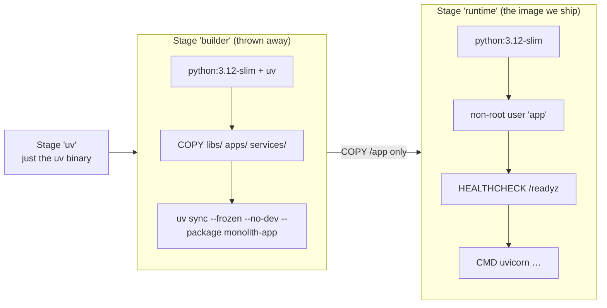

# A2 · 01 — Docker for Beginners (and our Dockerfile)

**Goal:** understand what a container image is, read our `docker/Dockerfile` line by line, and know *why* each choice was made.
**Prerequisites:** [Phase A1](../00-INDEX.md#phase-a1--foundation) chapters 01–02. **Time:** 45 min.
Every output below was captured from a real run on this repo.

---

## 1.1 The problem containers solve

"It works on my machine" usually means *my Python version, my installed libraries and my environment variables are different from yours.*
A **container** packages the program **and everything it needs** (Python, libraries, files) so it runs the same everywhere.

| Word | Meaning | Analogy |
|---|---|---|
| **Image** | A read-only, layered snapshot: OS bits + Python + our code | A recipe **plus** pre-measured ingredients in a box |
| **Container** | A running instance of an image | One cooked meal from that box |
| **Layer** | One step of the build, cached and shared | A page of the recipe; unchanged pages aren't redone |
| **Registry** | A server hosting images (Docker Hub, ghcr.io) | A supermarket |
| **Dockerfile** | The script that builds an image | The recipe card |
| **Volume** | Storage that outlives a container | A fridge: meals come and go, the fridge stays |

> 💡 **Learning Thought — a container is not a small virtual machine.** It is an ordinary process on your computer with a private view of the
> filesystem, network and process list. That is why it starts in milliseconds and a whole stack of 14 containers can fit in about **0.5 GB** of RAM (measured in chapter 02).

## 1.2 Our Dockerfile, line by line

File: [`docker/Dockerfile`](../../../docker/Dockerfile). **One image runs every app** in the repo (rule **E-2**); *what* runs is chosen by a build argument and the container command.



| Piece | Why |
|---|---|
| `FROM ghcr.io/astral-sh/uv:… AS uv` | Borrow the `uv` binary without installing it ourselves |
| **Multi-stage** (`builder` → `runtime`) | Build tools and caches stay in the throw-away stage; the shipped image is small (**282 MB**) and has a smaller attack surface |
| `uv sync --frozen --no-dev --package "${APP_PACKAGE}"` | `--frozen` = never touch `uv.lock` (reproducible); `--no-dev` = no test tools in production; `--package` = only this app's dependency closure |
| `RUN --mount=type=cache,target=/root/.cache/uv` | Re-use downloaded wheels between builds without baking them into a layer |
| `useradd --system --uid 10001 … app` + `USER app` | **Never run as root** inside a container; if the app is compromised, the attacker is an unprivileged user |
| `HEALTHCHECK … /readyz` | Docker (and Compose's `--wait`) can tell *ready* from *merely started* |
| `STOPSIGNAL SIGTERM` | A polite "please shut down" so the app can flush telemetry and close DB pools |
| `--no-access-log` | Uvicorn's plain-text access log would duplicate our structured JSON `http_request_completed` line |

▶ **Try it** — facts about the image we built:
```bash
docker images befastapi/app:dev --format '{{.Repository}}:{{.Tag}}  {{.Size}}'
docker run --rm --entrypoint id befastapi/app:dev
docker run --rm --entrypoint python befastapi/app:dev --version
```
```
befastapi/app:dev  282MB
uid=10001(app) gid=999(app) groups=999(app)
Python 3.12.15
```
Compare: `postgres:16.4` is 453 MB and `grafana/grafana` 478 MB — our whole application image is smaller than either.

▶ **Try it** — prove `--no-dev` worked:
```bash
docker run --rm --entrypoint python befastapi/app:dev -c "import pytest"
```
```
ModuleNotFoundError: No module named 'pytest'
```
Test tools are **not** in the production image. Good — and this is exactly what bit us (§1.3).

▶ **Try it** — see the layers (the biggest one is our `/app`, 137 MB, the virtualenv + source):
```bash
docker history befastapi/app:dev --format '{{.Size}}\t{{.CreatedBy}}' | head -8
```

## 1.3 ⚠️ The trap that only a real container could show

Our observability setup instrumented SQLAlchemy **and Redis** at start-up. On a developer machine everything is installed, so unit tests passed. In the image — which has only
*production* dependencies — Redis isn't there (no service uses it yet):

```
File ".../opentelemetry/instrumentation/redis/__init__.py", line 141, in <module>
    import redis
ModuleNotFoundError: No module named 'redis'
```
The container exited immediately. **Fix:** instrument a library *only if it is installed* (`importlib.util.find_spec`), plus a unit test that simulates its absence
(`libs/platform_observability/tests/test_setup.py`).

> 💡 **Learning Thought — "works in dev" and "works in the image" are different claims.** The dev environment has more installed than production. Only
> running the *real image* checks the second claim. That is the whole reason `make stack-check` exists.

> ⚠️ **Trap — `latest` tags and build context.** We pin image versions (`postgres:16.4`, `grafana/grafana:11.3.1`) so a build next year behaves like today's (rule **E-2**), and
> `.dockerignore` keeps `.git`, `.venv`, `.env` and caches out of the build (rule **E-3**: no secrets in images).

## 1.4 Useful commands (keep these handy)

| Command | What it does |
|---|---|
| `docker build -f docker/Dockerfile -t befastapi/app:dev .` | Build the image |
| `docker run --rm -it --entrypoint sh befastapi/app:dev` | Open a shell inside it (look around, then exit) |
| `docker ps` / `docker ps -a` | Running / all containers |
| `docker logs -f <name>` | Follow a container's output |
| `docker exec -it <name> sh` | Shell into a *running* container |
| `docker inspect --format '{{.State.Health.Status}}' <name>` | Health as Docker sees it |
| `docker stats --no-stream` | CPU / memory per container |

## 🧪 Labs
1. Build the image, then run `docker run --rm --entrypoint sh befastapi/app:dev -c "ls /app && ls /app/services"`. Which folders exist and why are the migrations there?
2. Change one line in a service and rebuild. Which layers were re-used from cache? (`docker build` prints `CACHED` per step.)
3. Run `docker run --rm --entrypoint touch befastapi/app:dev /etc/hello`. Why does it fail?
<details><summary>Solutions</summary>

1. `libs apps services pyproject.toml uv.lock …`. Workspace members are installed *editable*, so the source (including each service's `migrations/` folder, which isn't part of the Python package) must stay at `/app`.
2. Everything up to `COPY libs …` is cached; only the copy and the `uv sync` layers rebuild, and `uv`'s cache mount makes that fast.
3. We run as the unprivileged user `app`, which cannot write to `/etc`. That is the point of `USER app`.
</details>

## 🎯 Interview Questions
1. **Image vs container?** *An image is an immutable, layered template; a container is a running (or stopped) instance of it with a thin writable layer.*
2. **Why multi-stage builds?** *Keep compilers/caches/build deps out of the final image — smaller, faster to ship, fewer vulnerabilities.*
3. **Why run as a non-root user in a container?** *Limits the blast radius of a compromise; many platforms refuse root containers.*
4. **A container "works on my laptop" but crashes in Docker. First thing you check?** *Differences in installed dependencies and environment variables (dev extras vs production), then file paths/permissions.*
5. **What does `HEALTHCHECK` give you that "the process is running" doesn't?** *It tests the app can actually serve (here: `/readyz` verifies the database), so orchestrators route traffic only to healthy containers.*

## ✅ Self-check
- [ ] I can explain image, container, layer and volume with an analogy.
- [ ] I can say what each of the three stages in our Dockerfile is for.
- [ ] I can explain why `--no-dev` made a hidden dependency bug visible.
- [ ] I know why the image runs as user `app`.

## 📚 Further reading
- Docker — *Multi-stage builds*: <https://docs.docker.com/build/building/multi-stage/>
- Docker — Dockerfile reference: <https://docs.docker.com/reference/dockerfile/>
- uv — *Using uv in Docker*: <https://docs.astral.sh/uv/guides/integration/docker/>
- OWASP — Docker Security Cheat Sheet: <https://cheatsheetseries.owasp.org/cheatsheets/Docker_Security_Cheat_Sheet.html>

**Next:** [02 · Docker Compose: running the whole system →](02-compose-the-whole-system.md)
