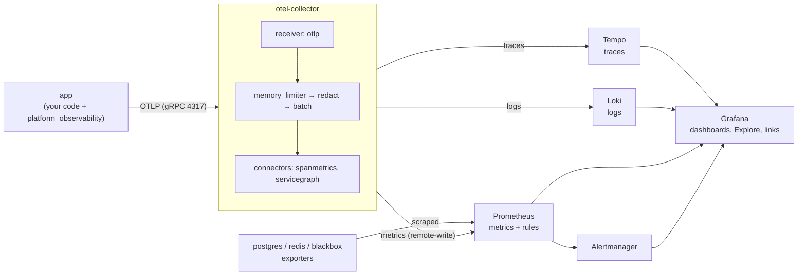

# A2 · 03 — The Observability Stack in Practice

**Goal:** follow **one request** through logs → traces → metrics → dashboards → alerts on the real stack, and know what each container is for.
**Prerequisites:** [A1 · 06 Observability for beginners](../phase-a1/06-observability-for-beginners.md), [A2 · 02](02-compose-the-whole-system.md). **Time:** 1.5 hours.
All data below was captured from a real run (service `notes`, request id `learn-ping-0001`).

---

## 3.1 The pipeline


**The key idea (rule O-1):** the app only ever talks to **one** thing — the Collector — in **one** language (OTLP). Swap Tempo for Jaeger, or all three backends for Datadog, by editing
[`otel-collector/config.yaml`](../../../deploy/observability/otel-collector/config.yaml); no application code changes.

| Container | Job | Host port |
|---|---|---|
| `otel-collector` | Receives telemetry, scrubs secrets, derives RED metrics from spans, fans out | 4317 / 4318 |
| `tempo` | Stores **traces** | 3200 |
| `loki` | Stores **logs** | 3100 |
| `prometheus` | Stores **metrics**, evaluates alert rules, scrapes the exporters | 9090 |
| `alertmanager` | Groups/routes alerts (local default: just shows them) | 9093 |
| `grafana` | The single window onto all of the above (login `admin` / `admin` locally) | 3000 |
| `postgres-exporter`, `redis-exporter` | Turn DB/cache internals into metrics | — |
| `blackbox-exporter` | Probes `/readyz` **from the outside** (external view of availability) | — |

## 3.2 Reading the Collector config (it's short)

```yaml
receivers:  { otlp: {protocols: {grpc: …4317, http: …4318}} }          # where data comes IN
processors:
  memory_limiter: …                  # protect the collector itself
  attributes/redact: …               # delete authorization/cookie/password/otp/token attributes (safety net behind in-app redaction)
  batch: …                           # send in groups, not one at a time
connectors:
  spanmetrics: …                     # spans in → RED metrics out (per app.service, route, status)
  servicegraph: …                    # who-calls-whom graph
exporters:  { otlp/tempo, prometheusremotewrite, otlphttp/loki }       # where data goes OUT
service.pipelines:
  traces:  otlp → [memory_limiter, redact, batch] → [tempo, spanmetrics, servicegraph]
  metrics: [otlp, spanmetrics, servicegraph] → [batch] → prometheusremotewrite
  logs:    otlp → [memory_limiter, redact, batch] → loki
```
Read it as *receive → process → export*, three times (one pipeline per signal). A **connector** is an exporter of one pipeline *and* a receiver of another — that is how traces feed the metrics pipeline.

> 💡 **Learning Thought — the Collector is a seam.** Everything vendor-specific lives behind it. That is what makes "swap the observability vendor" an ops change, not a code change.

## 3.3 Follow one request (the 3-click promise)

We send a request with a recognisable id:
```bash
curl -H "X-Request-ID: learn-ping-0001" localhost:8000/api/v1/notes/ping
```

### Step 1 — the **log** (Loki)
LogQL (Loki's query language): find the lines containing our request id.
```
{service_name=~".+"} |= "learn-ping-0001"
```
Result (real): 2 lines, both carrying the same `trace_id`:
```
http_request_completed | trace_id 9b474e016335… | app.service notes
ping_handled           | trace_id 9b474e016335… | app.service notes
```
Loki also attached the resource attributes as labels: `service_name="befastapi-monolith"`, `service_namespace="befastapi"`, `deployment_environment_name="local"`, `service_version="dev"`. In Grafana, the `trace_id` inside the JSON line becomes an **"Open trace"** link (a *derived field* configured in `datasources.yml`).

### Step 2 — the **trace** (Tempo)
Click through (or query Tempo for `9b474e01633537e75d6e3d5ab3111ace`). The real span tree:
```
GET /api/v1/notes/ping           [SERVER]    31.2 ms   app.service=notes
  fastapi.dependencies           [INTERNAL]  15.6 ms
  fastapi.endpoint               [INTERNAL]   8.8 ms
    notes.Ping                   [INTERNAL]   8.4 ms   ← OUR use-case span (@traced_use_case)
  fastapi.serialization          [INTERNAL]   0.1 ms
resource: service.name=befastapi-monolith, service.namespace=befastapi, deployment.environment.name=local
```
Reading it: the whole request took 31 ms; 8 ms was our use case (opening the unit of work and writing the outbox row); the rest is framework work. **This is how you find where time goes.**

### Step 3 — the **metric** (Prometheus)
Metrics from the app arrive as `http_server_request_duration_seconds_{bucket,count,sum}`. The real series (note **`app_service`**, our logical-service label, and the **route template**, never the raw URL):
```
http_server_request_duration_seconds_count{app_service="notes", http_request_method="GET",
    http_response_status_code="200", http_route="/api/v1/notes/ping", service_name="befastapi-monolith", …}  = 11
http_server_request_duration_seconds_count{… status="404", http_route="unmatched" …}                          = 1
notes_ping_received_total{app_service="notes", outcome="ok"}                                                   = 11     ← our business metric
```
- Unknown URLs are recorded as `http_route="unmatched"`, so a bot probing thousands of random paths cannot create thousands of series (cardinality, A1 chapter 06).
- The p95 latency for this service was `0.00925` s (9 ms): `histogram_quantile(0.95, sum by (le) (rate(http_server_request_duration_seconds_bucket{app_service="notes"}[5m])))`.

### Step 4 — **exemplars**: from a number to the story behind it
Latency histograms carry **exemplars** — a sample `trace_id` stored next to the number. Real:
```
series with exemplars: 4 | exemplars: 6
example exemplar labels: {'span_id': '0414930fefe6810e', 'trace_id': '389d93036edb4ab0831a5a903691b3a1'} value 0.0045
```
In Grafana, the green **diamonds on the "Latency p95 by route" panel** are exemplars: click one → *Query with Tempo* → the exact trace of a request in that latency bucket.

### The 3-click path in Grafana
1. **Dashboards → Platform → "RED overview (per logical service)"** (choose the service in the **Service** drop-down).
2. Click an **exemplar diamond** on *Latency p95 by route* → **trace** opens in Tempo.
3. On a span, click **Logs for this span** (or search logs for the `trace_id`) → the JSON log lines of exactly that request.

> 💡 **Learning Thought — correlation is made of identifiers.** Nothing magical links the three tools: the same `trace_id` string is written into the log line, the span and the metric exemplar, and
> Grafana is provisioned (as code, `datasources.yml`) to turn that string into a link.

## 3.4 SLOs and burn-rate alerts

Each service declares goals in `services/<name>/observability/slo.yaml`:
```yaml
slos:
  - {name: availability, objective: 99.9, window: 30d}
  - {name: latency, objective: 99.0, window: 30d, threshold_seconds: 0.5}
```
`tools/sync_observability.py` turns that into Prometheus alert rules (**6 per service**: 2 SLOs × 3 speeds). An **error budget** is `1 − objective` (0.1 % for 99.9 %). A **burn rate** says how fast you're spending it:
burn 1 = you'd use exactly the whole budget in 30 days; burn 14.4 = you'd use it in ~2 days. The first generated alert (real):

```yaml
- alert: NotesAvailabilityBudgetBurn
  expr: '( 5xx_ratio over 1h  > 0.0144 )  and  ( 5xx_ratio over 5m > 0.0144 )'     # 0.0144 = 14.4 × 0.001
  for: 2m
  labels: {severity: page, app_service: notes, slo: availability, burn_rate: '14.4'}
  annotations:
    summary: notes availability SLO is burning 14.4x faster than allowed (1h/5m)
    runbook_url: services/notes/observability/runbook.md#notes-availability-burn
```
| Speed | Burn | Windows (long / short) | Severity |
|---|---|---|---|
| fast | 14.4× | 1 h / 5 m | **page** |
| medium | 6× | 6 h / 30 m | **page** |
| slow | 1× | 3 d / 6 h | ticket |

Two windows must **both** exceed the threshold: the long window proves it's real, the short window proves it's still happening (so the alert clears quickly after a fix).

▶ **Try it** — the rules are valid and loaded (real output):
```
$ docker compose exec prometheus promtool check rules /etc/prometheus/rules/platform.rules.yml /etc/prometheus/generated-rules/notes.slo.rules.yml
Checking …platform.rules.yml        SUCCESS: 3 rules found
Checking …notes.slo.rules.yml       SUCCESS: 6 rules found
```
```
notes-slo | rules: 6 | states: inactive | health: ok
platform  | rules: 3 | states: inactive | health: ok
```
`inactive` = healthy (no alert firing). The generator **refuses to build** if a runbook section is missing (rule O-8): every alert links to `## notes-availability-burn` in `runbook.md`.

> ⚠️ **Trap — a latency threshold must be a histogram bucket boundary.** "Fast = under 0.3 s" can't be computed from buckets `…0.25, 0.5…`; the generator rejects it with a clear error (`tools/tests/test_sync_observability.py`).

## 3.5 Platform health

`Platform health` dashboard + Prometheus targets (real):
```
blackbox-readyz  up    probe of http://app:8000/readyz   → probe_success = 1
otel-collector   up    postgres up    redis up    prometheus up
```
`probe_success` comes from the **blackbox exporter** hitting `/readyz` over the network — the view a user would have, independent of what the app thinks of itself.

## 3.6 Telemetry must never hurt the app (rule O-11) — proven

We stopped the Collector and kept calling the app:
```
$ docker compose stop otel-collector
200 200 200 200 200                      ← requests still succeed
readyz: ok        app health: healthy, restarts: 0
stdout JSON logs still written: 10 lines (2 per request)
$ docker compose start otel-collector    ← and it recovers by itself
```
Exports are batched and asynchronous; when the Collector is unreachable, data is dropped (and the failure counted) rather than slowing or failing a request. Because logs also go to **stdout**, `docker logs` works even with no observability stack at all.

## 3.7 Gotchas that bit us (and the fixes)

| Symptom | Cause | Fix |
|---|---|---|
| App metrics missing for a minute after start | OpenTelemetry exports metrics every **60 s** by default | `OTEL_METRIC_EXPORT_INTERVAL=15000` in Compose (dev) |
| "Collector accepted spans" panel empty | Metric is `otelcol_receiver_accepted_spans` — **no `_total`** in this collector version | Fixed dashboard + alert rule; every panel's query was then run against live Prometheus |
| "Error ratio" panel showed **No data** | No 5xx yet ⇒ the division has no series | Query now ends `or (total * 0)` so it shows a flat 0 |
| Loki shows `trace_id`, `span_id` next to labels | Those are Loki *structured metadata* (searchable, **not** indexed labels) | Expected; labels stay low-cardinality |
| Dashboards show nothing right after boot | Prometheus needs a couple of scrapes/exports | Send some traffic, wait ~30 s |

## 🧪 Labs
1. Send 20 requests, then find your **own** request in Grafana → Explore → Loki with `{service_name=~".+"} |= "<your request id>"`. Click *Open trace*.
2. In Explore → Prometheus run `sum by (http_route) (rate(http_server_request_duration_seconds_count[5m]))`. Which route is `unmatched`?
3. Stop the collector, send traffic, restart it. Which of your requests have a trace? (Hint: only the ones sent while it was up.) Why is that acceptable?
4. Edit `services/<name>/observability/slo.yaml` (objective 99.9 → 99.99) and run `make obs-sync` then reload Prometheus (`docker compose exec prometheus kill -HUP 1`). What number replaced `0.0144`?
<details><summary>Solutions</summary>

2. Requests whose path matched no route (404s) — see §3.3 step 3. 3. Traces/metrics from the downtime are lost, logs on stdout are not. Acceptable because losing *telemetry* is cheaper than failing *customers* (rule O-11). 4. `14.4 × 0.0001 = 0.00144`.
</details>

## 🎯 Interview Questions
1. **Why put an OpenTelemetry Collector between the app and the backends?** *One protocol out of the app; vendor/backend changes, sampling, redaction and fan-out become configuration instead of code.*
2. **What is an exemplar and why is it useful?** *A sample trace id attached to a metric data point, so you can jump from "p95 is bad" to a concrete slow trace.*
3. **Explain multi-window, multi-burn-rate alerting.** *Alert on how fast the error budget is being consumed, requiring a long window (significance) and a short window (still happening); fast burns page, slow burns ticket.*
4. **Why probe `/readyz` from a separate blackbox exporter?** *It measures availability as a client sees it (network path included), independent of the app's own self-reporting.*
5. **How do you stop observability from taking production down?** *Async, batched, bounded exporters that drop on failure; exception-safe log handlers; resource limits on the collector; and a test that kills the collector while requests keep flowing.*
6. **Why is `http_route` a template and not the raw path?** *To keep metric cardinality bounded; raw paths with ids (or attacker-chosen junk) create unbounded series.*

## ✅ Self-check
- [ ] I can name each observability container and what it stores or does.
- [ ] I can follow a request id from a log line to its trace to its metric.
- [ ] I can explain error budget, burn rate and why two windows are used.
- [ ] I can explain why stopping the collector doesn't break the app.

## 📚 Further reading
- OpenTelemetry Collector — configuration: <https://opentelemetry.io/docs/collector/configuration/>
- Grafana Tempo — documentation: <https://grafana.com/docs/tempo/latest/>
- Grafana Loki — LogQL: <https://grafana.com/docs/loki/latest/query/>
- Prometheus — alerting rules: <https://prometheus.io/docs/prometheus/latest/configuration/alerting_rules/>
- Google SRE Workbook — *Alerting on SLOs*: <https://sre.google/workbook/alerting-on-slos/>

**Next:** [04 · What the live run taught us →](04-what-the-live-run-taught-us.md)
