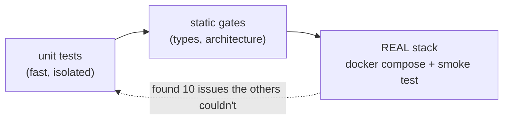

# A2 · 04 — What the Live Run Taught Us

**Goal:** learn from the ten things that broke the first time we booted the real stack — none of which the unit tests could see.
**Prerequisites:** A2 chapters 01–03. **Time:** 30 min. (A real case study: read it like a post-mortem.)

> **The meta-lesson.** At the end of Phase A1 we had green tests, strict types and passing architecture checks. The first `docker compose up` still failed **four separate ways** before
> the app even served a request, and the dashboards were wrong in three more. Unit tests prove *your code does what you meant*; only running the **real assembled system** proves *the assembly works*.

## The ten findings

| # | Symptom | Root cause | Fix | Guard added |
|---|---|---|---|---|
| 1 | Container exits instantly: `ModuleNotFoundError: No module named 'redis'` | Start-up imported the Redis instrumentor unconditionally; the **production image** has no `redis` (no service uses it yet) | Instrument a library only if `importlib.util.find_spec` finds it | `libs/platform_observability/tests/test_setup.py` |
| 2 | App crashes at start-up: `AttributeError: 'str' object has no attribute 'copy'` inside logging | Our OTLP log handler formatted each record **twice**; structlog's formatter expects the original event dict the second time | Render once with our JSON formatter, pass OpenTelemetry a clean record | `tests/test_log_export.py` (JSON body, no warnings) |
| 3 | A warning for **every log line**: `Invalid type … _FixedFindCallerLogger for attribute value` | structlog attaches helper objects to each `LogRecord`; OpenTelemetry tried to export them as attributes | Strip structlog's private attributes before handing the record over | same test asserts no such warnings |
| 4 | `migrate-*` exits **0** but `relation "…outbox" does not exist` | A pre-check query auto-started a transaction, so Alembic didn't commit; closing the connection rolled everything back | `connection.commit()` before running migrations | fixed in the generator template; verified by the live stack check |
| 5 | Smoke test: `/readyz` → 404, yet the container is healthy | Another process on this machine already owned `127.0.0.1:8000` | Configurable `APP_PORT`; `stack_check.sh` passes it to the smoke test | documented in troubleshooting |
| 6 | `Platform health` panels empty; one alert could never fire | Collector metrics are `otelcol_*_spans`, **not** `…_total` | Corrected names in dashboard and rule | every dashboard query is run against live Prometheus |
| 7 | App metrics absent for a minute | SDK default export interval is 60 s | `OTEL_METRIC_EXPORT_INTERVAL=15000` for local | in `.env.example` |
| 8 | "Error ratio" showed *No data* | No 5xx ⇒ no series | `… or (total * 0)` | dashboard query validated |
| 9 | `docker build` → `open ~/.docker/buildx/current: permission denied` | Two **root-owned** files in the user's `~/.docker` | Private `DOCKER_CONFIG` copy for automation; the user fixes ownership once | troubleshooting entry |
| 10 | A new test errored during *collection* | We aliased an import as `setup_module`; **pytest treats a module-level `setup_module` as an xunit fixture** and calls it. Also `from pkg import setup` returns the *function*, shadowing the submodule | Different alias; import the module explicitly with `importlib.import_module` | comment in the test |

## Patterns worth remembering

### 1. Optional ≠ unconditional
> 💡 If a feature is optional, **test the absence**. Our code *claimed* Redis instrumentation was optional but the import wasn't guarded. A test that simulates "library missing" (`monkeypatch` of `find_spec`) is cheap and would have caught it.

### 2. Observability code must be exception-safe (rule O-11)
Python's `logging` calls handlers **inline, inside business code**. A bug in your telemetry handler is therefore a bug in *every request*. Finding #2 turned a log call into a start-up crash.
The handler now catches everything (`handleError`) — and `test_a_failing_exporter_never_raises_into_business_code` proves it.

### 3. Don't trust an exit code; check the outcome
Finding #4: "job succeeded" and "tables exist" are different statements. The smoke test checks the **result** (a trace in Tempo, a metric in Prometheus), not just that commands returned 0.

### 4. Look at the raw data once
Findings #6–#8 were invisible until we queried the real systems (names, label sets, empty panels). `tools/obs_smoke.py` and the "run every dashboard query" step now do that automatically.

### 5. Diagnose the environment before the code
Findings #5 and #9 were not bugs in the repo. `lsof -nP -iTCP:8000 -sTCP:LISTEN` and `ls -l ~/.docker/buildx` solved them in a minute. Ask "what else is on this machine?" early.

## 🧪 Labs
1. Reproduce #1: in a scratch container run `python -c "import redis"` from the runtime image. Then read `_instrument_optional()` and explain why it can't crash any more.
2. Reproduce #4 on paper: why does `SELECT` before `context.begin_transaction()` change Alembic's behaviour? (Hint: SQLAlchemy 2 *autobegin*.)
3. Think: which of the ten findings would a *bigger unit-test suite* never have caught? Which would a *code review*?

Discussion

3. #1, #4, #5, #6, #7, #9 depend on the real image, a real database, real ports or real third-party metric names — no amount of unit tests covers them. #2/#3/#10 are code bugs that a test of the *real* log pipeline would catch (we added those). A reviewer might spot #10's `setup_module` clash only by experience.

## 🎯 Interview Questions
1. **Why isn't a green unit-test suite enough before releasing infrastructure changes?** *It exercises your code against fakes. Integration issues — missing production dependencies, transaction semantics on a real DB, port clashes, third-party naming — only appear in the assembled system.*
2. **What is a smoke test and what makes a good one?** *A fast end-to-end check of the critical path. A good one asserts on outcomes at each hop (log → trace → metric), polls for asynchronous results with a timeout, and tears down after itself.*
3. **Why must a logging handler never raise?** *Logging runs inline in request code; an exception in the handler becomes a request failure. Observability must be fail-safe.*
4. **How do you design "optional dependency" code?** *Detect availability at runtime, skip cleanly, and add a test that simulates the dependency being absent.*

## ✅ Self-check
- [ ] I can explain why each of the ten problems escaped the earlier gates.
- [ ] I know the three "never" rules: never raise from telemetry, never trust exit codes alone, never assume optional means guarded.
- [ ] I know the first two commands I run when a port or permission error appears.

## 📚 Further reading
- *Release It!* (Michael Nygard) — stability patterns such as "fail fast" and "bulkheads".
- Python — `logging.Handler.handleError`: <https://docs.python.org/3/library/logging.html#logging.Handler.handleError>
- pytest — xunit-style `setup_module`: <https://docs.pytest.org/en/stable/how-to/xunit_setup.html>
- Alembic — transactions & `transaction_per_migration`: <https://alembic.sqlalchemy.org/en/latest/cookbook.html>

**Back to the [index](../00-INDEX.md).**
