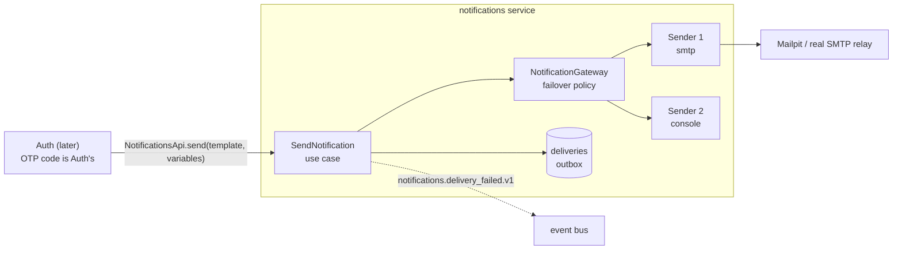
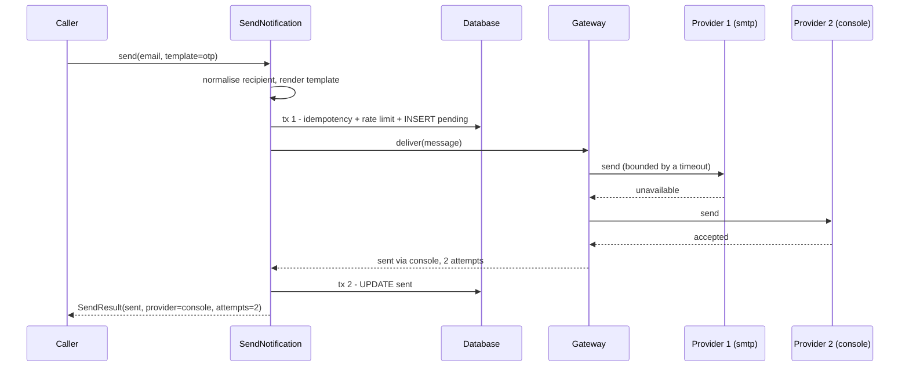

# B · 01 — The Notifications Service: Concepts and Design

**Goal:** explain *why* sending a message is a whole service, read every part of `services/notifications` (domain → gateway → use case → contract), and predict what the gateway does when a provider fails.
**Prerequisites:** [A1 · 03 Boundaries, contracts & layers](../phase-a1/03-boundaries-contracts-and-layers.md) and [A1 · 05 A request end to end](../phase-a1/05-a-request-end-to-end.md). **Time:** 60 min.
Every command output below was captured from this repo; the live-stack run is in [B · 02](02-hands-on-live-stack.md).

> **The problem.** "Send an OTP by SMS" sounds like one line of code. In practice the vendor changes next year, goes down on Friday evening, rejects a mistyped number, gets abused to send thousands of messages to premium-rate phones, and the code you sent lands — in plain text — in somebody's log file. Notifications is the one place that absorbs all of that, so the other services (Auth first) can say *"deliver this template to this person"* and stop caring.

---

## 1.1 Concept first

**Analogy — a post-office sorting desk.** You hand the clerk a letter and an address. The clerk knows several couriers. If the first courier's van is broken, the clerk tries the second. If the address doesn't exist, the clerk does **not** try more couriers — they hand it back. The clerk also keeps a ledger ("letter to J. S., via courier 2, delivered") but never copies the letter's contents into it, and refuses to post 500 letters to the same house in an hour.

| Word | Meaning here |
|---|---|
| **Channel** | The kind of message: `sms` or `email` (push later) |
| **Provider / vendor** | The company or server that actually delivers (an SMS vendor, an SMTP relay) |
| **Sender (adapter)** | Our small class that talks to *one* provider. The only vendor-specific code (rule **X-7**) |
| **Gateway (facade)** | One object that knows the *chain* of senders per channel and applies the failover policy |
| **Provider chain** | Ordered list per channel, e.g. `smtp,console`: try left to right |
| **Failover** | The first provider failed *transiently*, so the gateway tries the next |
| **Template** | A fixed message shape with placeholders (`otp`, `welcome`, `password_changed`). Callers send a *template name + variables*, never free text |
| **Delivery** | Our record of one attempt to reach one person (status `pending → sent | failed`) |
| **Idempotency key** | A caller-chosen string: "if you have already done *this*, give me the same answer, don't do it twice" |
| **Masked recipient / digest** | `a***@example.com` for humans; a keyed hash for counting without storing the address |



> 💡 **Learning Thought — who owns what.** *Auth owns the OTP code* (generating, hashing, expiry, attempts, "static OTP" test mode) because that is a **security decision**. *Notifications owns delivery* because that is an **operational problem**. Notifications knows nothing about users, tokens or sessions; it depends on **no** other service. If you catch yourself importing `auth_contracts` here, stop — the recipient is *passed in*.

### The behaviour in one picture



The database transaction is **not** held open while the providers are called (a provider call can take seconds; a transaction held that long pins a connection and row locks). Two short transactions with the slow work in between is the standard shape.

## 1.2 The design decisions (and what we rejected)

| Decision | Chosen | Rejected, and why |
|---|---|---|
| Failure semantics | **Reject stops the chain; unavailable/timeout/crash fails over** | "Always try everyone": a mistyped phone number would be sent to every vendor — cost and spam for no gain |
| Message content | **Templates only**, variables checked exactly | Free text: a stolen caller credential becomes a phishing cannon; typos in variables silently ship broken messages |
| What we store | **Masked recipient + keyed digest**, never body, never full address | Full log: a database leak becomes a contact list *and* a list of valid OTPs |
| Counting per recipient | **HMAC-SHA256 with a secret pepper** | Plain SHA-256: phone numbers are guessable; anyone with the table could rebuild them |
| Transactions | **Short tx → provider call → short tx** | One long tx: pinned connections; but see the honest trade-off below |
| Idempotency | **Optional key, unique in the DB; a *failed* delivery may be retried under the same key** | Caching results in memory: lost on restart and not shared between processes |
| Abuse defence | **Per-recipient hourly cap**, `429` + `Retry-After` | None: SMS-pumping fraud (attackers trigger OTPs to premium numbers they own) bills *you* |
| Dev conveniences | **console / memory / static senders + dev endpoints, refused in production** (rule **X-11**) | Remember-not-to: a console sender in production prints every OTP into your log pipeline |

> ⚠️ **The honest trade-off — at-least-once.** If the process dies *after* the provider accepted the message but *before* tx 2 records it, the row stays `pending` although the message went out; a retry with the same key would send it again. We chose that side on purpose: for OTPs and transactional mail a duplicate is annoying, a missing message locks a user out. The opposite choice (at-most-once) would silently drop messages on every crash.

## 1.3 Walk through the code

```
services/notifications/
├── contracts/src/notifications_contracts/     # the ONLY thing other services may import
│   ├── dto.py        Channel, SendRequest, SendResult, DeliveryInfo
│   ├── api.py        NotificationsApi (Protocol): send, get_delivery
│   ├── errors.py     NotificationsInvalidRequest / RateLimited / IdempotencyConflict / Unavailable, DeliveryNotFound
│   ├── events.py     DeliveryFailed  ("notifications.delivery_failed.v1")
│   └── http_client.py  NotificationsHttpClient (used after extraction)
└── service/src/notifications_service/         # private
    ├── domain/          recipients.py  templates.py  providers.py  delivery.py  errors.py   (pure Python)
    ├── application/     ports.py  gateway.py  telemetry.py  services/send_notification.py
    ├── infrastructure/  db/ (tables, repository, UoW)   providers/ (console memory static smtp registry)
    ├── api/             internal/router.py (service-to-service)   dev/router.py (dev only)
    ├── contracts_impl.py   module.py   settings.py   testing.py
```

### Domain: pure rules, no framework
[`recipients.py`](../../../services/notifications/service/src/notifications_service/domain/recipients.py) normalises (`+1 (415) 555-0123` → `+14155550123`; `Asha@Example.COM` → `asha@example.com`) so the same person can't dodge the rate cap by changing capitalisation, and [`templates.py`](../../../services/notifications/service/src/notifications_service/domain/templates.py) renders a template only if the variables match **exactly** (missing *and* unexpected both fail). Variable values are data: `{0.__class__}` is printed literally, never evaluated (there is a test for it).

### The port: the only thing a vendor adapter must satisfy
From [`application/ports.py`](../../../services/notifications/service/src/notifications_service/application/ports.py):

```python
class SenderRejected(Exception):
    """The provider understood the request and refused it permanently (bad number, blocked address)..."""

class SenderUnavailable(Exception):
    """The provider could not be reached or had a transient problem. The gateway fails over."""

class Sender(Protocol):
    name: str
    channels: frozenset[Channel]

    async def send(self, message: OutboundMessage) -> None:
        """Return normally when the provider ACCEPTED the message. Raise SenderRejected/SenderUnavailable otherwise."""
```
An adapter has **one job**: translate "the vendor said X" into *accepted / rejected / unavailable*. Everything else is the gateway's.

### The gateway: the failover policy in 30 lines
From [`application/gateway.py`](../../../services/notifications/service/src/notifications_service/application/gateway.py):

```python
async def _try(self, sender: Sender, message: OutboundMessage) -> Attempt:
    started = time.perf_counter()
    outcome = AttemptOutcome.SENT
    try:
        async with asyncio.timeout(self._timeout):
            await sender.send(message)
    except SenderRejected:
        outcome = AttemptOutcome.REJECTED
    except SenderUnavailable:
        outcome = AttemptOutcome.UNAVAILABLE
    except TimeoutError:
        outcome = AttemptOutcome.TIMEOUT
    except Exception as exc:  # noqa: BLE001 - a buggy third-party adapter must not take the gateway down
        self._log.error("provider_crashed", provider=sender.name, error_type=type(exc).__name__)
        outcome = AttemptOutcome.UNAVAILABLE
    return Attempt(sender.name, outcome, time.perf_counter() - started)
```
and in `deliver`, after each attempt: `if attempt.outcome in (SENT, REJECTED): break` — success or rejection ends the walk, anything else continues to the next sender.

| Provider says | Outcome | Gateway does |
|---|---|---|
| accepted | `sent` | stop, report success |
| `SenderRejected` | `rejected` | **stop**, report rejection |
| `SenderUnavailable` | `unavailable` | try next |
| takes longer than the timeout | `timeout` | cancel, try next |
| any other exception (adapter bug) | `unavailable` | log `provider_crashed`, try next |
| chain exhausted | — | report failure (all attempts listed) |

> 💡 **Learning Thought — the broad `except Exception` is deliberate here.** The repo bans blanket excepts (`BLE001`), but at an *extension seam* where third-party code runs, "a buggy adapter must not take the gateway down" is the whole point. The `noqa` carries its justification on the same line — that is the rule for every exception to a rule.

### The use case: orchestration, not business logic
[`send_notification.py`](../../../services/notifications/service/src/notifications_service/application/services/send_notification.py) reads top-to-bottom:

```python
async def __call__(self, request: SendRequest) -> SendResult:
    try:
        recipient = normalise_recipient(request.channel, request.recipient)
        rendered = render(request.template, request.channel, request.variables)
    except NotificationsDomainError as exc:
        raise NotificationsInvalidRequest(exc.message, code=exc.code, details=exc.details) from exc
    digest = recipient_digest(self._policy.pepper, request.channel, recipient)

    delivery, replay = await self._open(request, recipient, digest)   # tx 1
    if replay:
        return _result(delivery)

    result = await self._gateway.deliver(OutboundMessage(...))        # slow, no transaction
    return await self._close(delivery, result)                        # tx 2 (+ outbox event on failure)
```
Note the **translation of errors at the layer boundary**: the domain raises its own (`InvalidRecipient`), the application converts to the *contract's* `NotificationsInvalidRequest` so that callers — in-process or over HTTP — see one stable vocabulary.

### The failure event
When delivery ends in failure, tx 2 also writes `notifications.delivery_failed.v1` to the **outbox** in the *same* transaction as the status change (rule **D-5**). The event carries ids and an error code — **no recipient, no body** (rule **C-6**). Nobody subscribes yet; Auth will (Phase C) to offer the user another channel.

### Production guard
From [`settings.py`](../../../services/notifications/service/src/notifications_service/settings.py):

```python
@model_validator(mode="after")
def _production_guard(self) -> "NotificationsSettings":
    ...
    if self.env != "production":
        return self
    problems: list[str] = []
    used_dev = DEV_ONLY_PROVIDERS & {*self.sms_providers, *self.email_providers}
    if used_dev:
        problems.append(f"dev-only providers {sorted(used_dev)} are configured")
    if self.dev_endpoints:
        problems.append("NOTIFICATIONS_DEV_ENDPOINTS is enabled")
    if self.digest_pepper.get_secret_value() == _DEV_PEPPER:
        problems.append("NOTIFICATIONS_DIGEST_PEPPER is still the development default")
    if problems:
        raise ValueError("refusing to start in production: " + "; ".join(problems))
    return self
```
Failing at **start-up** beats failing quietly at 3 a.m. (rule **X-11**; compare "fail fast on unsafe combos", rule **X-4**).

▶ **Try it** — run the whole service's tests (no Docker needed):
```bash
uv run pytest services/notifications -q
```
```
76 passed in 3.60s
```
and see the architecture rules for this service pass:
```bash
uv run lint-imports | grep notifications_service
```
```
L-1: notifications_service layering (api|infrastructure > application > domain) KEPT
L-2/L-3: notifications_service domain and application never directly import 
```

> ⚠️ **Trap — `pytest` can't `import conftest` here.** The repo runs pytest in `importlib` mode, so a test file doing `from conftest import Harness` fails with `ModuleNotFoundError: No module named 'conftest'`. Shared helpers therefore live in the package (`notifications_service/testing.py`, like `platform_security.testing`) and only *fixtures* stay in `conftest.py`.

## 1.4 The contract: what other services see

[`api.py`](../../../services/notifications/contracts/src/notifications_contracts/api.py) is deliberately tiny:

```python
class NotificationsApi(Protocol):
    async def send(self, request: SendRequest) -> SendResult: ...
    async def get_delivery(self, delivery_id: UUID) -> DeliveryInfo: ...
```
There is **no** `send_sms()` / `send_email()` and no vendor vocabulary. Two implementations satisfy it: the in-process one ([`contracts_impl.py`](../../../services/notifications/service/src/notifications_service/contracts_impl.py)) and the HTTP client ([`http_client.py`](../../../services/notifications/contracts/src/notifications_contracts/http_client.py)) which maps the uniform HTTP error body *back* into the same exception classes. The **contract tests** run identical assertions against both ([`test_contract.py`](../../../services/notifications/service/tests/test_contract.py)) — that is what makes later extraction "a wiring change".

## 🧪 Labs
1. **Predict, then check.** Chain `static,console`, with `static` set to `reject`. Which provider is called? What does the caller get (status code and error code)? Then do the same with `static` set to `unavailable`. Verify with `services/notifications/service/tests/test_send.py` (read the tests, change nothing).
2. **Add a template** `login_alert` (`"New sign-in from {device}."`). Which file? What must you add to prove it works? Make `uv run pytest services/notifications -q` green.
3. **Find the guard.** Without running anything, name the three things that stop a production start. Then prove each with one `pytest` parametrised case (hint: `test_settings.py`).

<details><summary>Solutions</summary>

1. `static` rejects ⇒ the chain **stops**: `console` is never called; the caller gets `422` with code `NOTIFICATIONS_RECIPIENT_REJECTED` (and the delivery row is `failed`, an outbox event is written). With `unavailable` ⇒ failover to `console`, status `sent`, `attempts: 2`.
2. Add a `Template("login_alert", subject="New sign-in", body="New sign-in from {device}.")` entry in [`templates.py`](../../../services/notifications/service/src/notifications_service/domain/templates.py). Prove it with a test in `test_domain.py` that renders it for both channels and one that omits `device` (expect `TemplateVariablesMismatch`).
3. Dev-only providers (`console`, `memory`, `static`), `NOTIFICATIONS_DEV_ENDPOINTS=true`, and the default digest pepper. `test_dev_things_refuse_to_start_in_production` already has one parametrised case for each.
</details>

## 🎯 Interview Questions
1. **Why does a "rejected" recipient stop the provider chain while "unavailable" doesn't?** *Rejection is information about the request (bad number) — another vendor would reject it too, at extra cost and with spam risk. Unavailability is information about the vendor, so another vendor may succeed.*
2. **Why not hold one database transaction around the whole send?** *The provider call is slow and unbounded by us; a transaction open that long pins a pooled connection and locks. We commit "pending" first, call the provider, then commit the result — accepting at-least-once delivery on a crash.*
3. **What is an idempotency key and what does it buy you here?** *A caller-chosen id making repeated requests safe: the second request with the same key returns the first result instead of sending again. It is enforced by a unique index, so it survives restarts and works across processes.*
4. **Why store a keyed digest of the recipient?** *To count deliveries per person (rate limit) without storing their address. HMAC with a secret pepper prevents rebuilding phone numbers by brute force from a leaked table.*
5. **Why must `console` and `static` senders fail to start in production?** *Console prints one-time codes into logs; static pretends to deliver. Both are silent security/correctness failures, so the process refuses to start (rule X-11).*
6. **How does Notifications avoid depending on Auth, yet serve Auth's OTPs?** *Dependencies point one way: Auth calls Notifications through `notifications_contracts`; the recipient and variables are passed in, so Notifications never needs to know about users or tokens.*

## ✅ Self-check
- [ ] I can draw the send flow including both transactions and the failover.
- [ ] I can say, for each provider outcome, what the gateway does and why.
- [ ] I can explain at-least-once delivery and where the window is.
- [ ] I know what is stored in `notifications.deliveries` — and what deliberately is not.
- [ ] I can name the rule that makes dev-only adapters refuse to start in production.

## 📚 Further reading
- Google SRE book — *Handling Overload* (why bounded timeouts and failover policies matter): <https://sre.google/sre-book/handling-overload/>
- OWASP — *Authentication Cheat Sheet* (OTP delivery and abuse): <https://cheatsheetseries.owasp.org/cheatsheets/Authentication_Cheat_Sheet.html>
- RFC 5321 — SMTP reply codes (why 4xx = try later, 5xx = permanent): <https://datatracker.ietf.org/doc/html/rfc5321#section-4.2>
- Stripe — *Idempotent requests*: <https://docs.stripe.com/api/idempotent_requests>

**Next:** [B · 02 — Hands-on with the live stack →](02-hands-on-live-stack.md)
