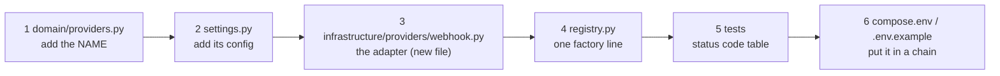

# B · 04 — Lab: Add a Vendor Adapter

**Goal:** add a brand-new provider ("webhook": a generic HTTP vendor) to the gateway **without touching the gateway, the use case, the contract or any other service** — and prove it with tests, the architecture check, and a failover chain.
**Prerequisites:** [B · 01](01-notifications-concepts-and-design.md). **Time:** 45 min. Docker not needed.
This is the payoff of the whole design: a vendor is *one file plus three one-line registrations*. The solution below was applied to the repo, the full test suite, `mypy --strict`, `ruff` and `lint-imports` were run (output at the end), and then it was reverted so the repo stays vendor-free.

> Real vendors differ in detail (auth headers, payload shape, status codes) but share one problem: **translate "what the vendor said" into accepted / rejected / unavailable.** That translation table is the only thinking in an adapter.

---

## 4.1 The map of what to touch



| Step | File | Why this file |
|---|---|---|
| 1 | `domain/providers.py` | the **closed set** of provider names — config may only choose from it, and it's the metric label allow-list (rule **O-5**) |
| 2 | `settings.py` | `NOTIFICATIONS_WEBHOOK_URL` (secrets would be `SecretStr`, never logged) |
| 3 | `infrastructure/providers/webhook.py` | the only place that knows the vendor exists (rule **X-7**) |
| 4 | `infrastructure/providers/registry.py` | name → factory. An `assert` fails at import if steps 1 and 4 disagree |
| 5 | `tests/test_webhook_lab.py` | proves every status code maps to the right outcome |
| 6 | `compose.env` | `NOTIFICATIONS_SMS_PROVIDERS=webhook,console` |

## 4.2 The adapter and its translation table

| The vendor answers | Our outcome | Because |
|---|---|---|
| `2xx` | accepted (return normally) | they took responsibility for delivery |
| `429`, `5xx` | `SenderUnavailable` | their problem or throttling: **try the next provider** |
| other `4xx` | `SenderRejected` | *our request* is wrong (bad number/format): another vendor won't help, **stop** |
| connection error / timeout | `SenderUnavailable` | can't reach them: try the next |

`infrastructure/providers/webhook.py`:

```python
"""A generic HTTP vendor: POST the message as JSON to a URL. The template for wiring a real SMS/email API."""

import httpx

from notifications_contracts import Channel
from notifications_service.application.ports import (
    OutboundMessage,
    SenderRejected,
    SenderUnavailable,
)


class WebhookSender:
    name = "webhook"
    channels = frozenset(Channel)

    def __init__(
        self,
        url: str,
        *,
        timeout_seconds: float = 5.0,
        transport: httpx.AsyncBaseTransport | None = None,
    ) -> None:
        self._url = url
        self._client = httpx.AsyncClient(timeout=timeout_seconds, transport=transport)

    async def send(self, message: OutboundMessage) -> None:
        payload = {
            "channel": message.channel.value,
            "to": message.recipient,
            "subject": message.subject,
            "text": message.body,
        }
        try:
            response = await self._client.post(self._url, json=payload)
        except httpx.HTTPError as exc:  # connect error, read timeout, protocol error…
            raise SenderUnavailable(type(exc).__name__) from exc
        if response.status_code >= 500 or response.status_code == 429:
            raise SenderUnavailable(
                f"vendor answered {response.status_code}"
            )  # their problem or throttling: try the next
        if response.status_code >= 400:
            raise SenderRejected(
                f"vendor answered {response.status_code}"
            )  # our request is the problem: stop
```

> ⚠️ **Trap — `429` is *not* a rejection.** A rate-limit answer says "slow down", not "your request is bad". Treating it as `SenderRejected` would stop the chain and drop a perfectly good message; mapping it to `SenderUnavailable` lets the next provider take over. When in doubt ask: *would a different vendor give a different answer?*

## 4.3 The three one-line registrations

```python
# domain/providers.py
PROVIDER_NAMES: frozenset[str] = frozenset({"console", "memory", "static", "smtp", "webhook"})

# settings.py  (next to the smtp_* settings)
webhook_url: str = "http://localhost:9999/send"

# infrastructure/providers/registry.py  (import WebhookSender, then add to _FACTORIES)
"webhook": lambda s: WebhookSender(s.webhook_url, timeout_seconds=s.attempt_timeout_seconds),
```
It is **not** in `DEV_ONLY_PROVIDERS` — a real HTTP vendor is allowed in production. (Had it been a fake, it would go in that set, and the production guard would automatically refuse it.)

## 4.4 The test: a status-code table with a fake transport

`httpx.MockTransport` replaces the network, so tests are instant and need no vendor account:

```python
import httpx
import pytest

from notifications_contracts import Channel
from notifications_service.application.ports import (
    OutboundMessage,
    SenderRejected,
    SenderUnavailable,
)
from notifications_service.infrastructure.providers.webhook import WebhookSender

MESSAGE = OutboundMessage(Channel.SMS, "+14155550123", None, "hello")


def sender(handler) -> WebhookSender:  # type: ignore[no-untyped-def]
    return WebhookSender("http://vendor.test/send", transport=httpx.MockTransport(handler))


async def test_2xx_is_accepted_and_the_payload_is_what_the_vendor_expects() -> None:
    seen: list[httpx.Request] = []

    def handler(request: httpx.Request) -> httpx.Response:
        seen.append(request)
        return httpx.Response(202)

    await sender(handler).send(MESSAGE)
    assert seen[0].url == "http://vendor.test/send" and b'"to":"+14155550123"' in seen[0].content


@pytest.mark.parametrize(
    ("status", "expected"),
    [
        (400, SenderRejected),
        (422, SenderRejected),
        (429, SenderUnavailable),
        (500, SenderUnavailable),
        (503, SenderUnavailable),
    ],
)
async def test_status_codes_map_to_reject_or_fail_over(
    status: int, expected: type[Exception]
) -> None:
    with pytest.raises(expected):
        await sender(lambda r: httpx.Response(status)).send(MESSAGE)


async def test_network_errors_fail_over() -> None:
    def boom(request: httpx.Request) -> httpx.Response:
        raise httpx.ConnectError("refused")

    with pytest.raises(SenderUnavailable):
        await sender(boom).send(MESSAGE)
```

## 4.5 Run the gates

```bash
uv run ruff check services/notifications && uv run ruff format --check services/notifications
uv run mypy -p notifications_service
uv run lint-imports | grep -E "notifications_service|Contracts:"
uv run pytest services/notifications -q
NOTIFICATIONS_SMS_PROVIDERS=webhook,console uv run python -c "
from notifications_service.settings import NotificationsSettings
from notifications_service.infrastructure.providers.registry import build_senders
s=NotificationsSettings(); print(s.sms_providers, list(build_senders(s)))"
```
```
Success: no issues found in 40 source files
L-1: notifications_service layering (api|infrastructure > application > domain) KEPT
L-2/L-3: notifications_service domain and application never directly import 
Contracts: 5 kept, 0 broken.
........................................................................ [ 86%]
...........                                                              [100%]
83 passed in 3.57s
['webhook', 'console'] ['webhook', 'console']
```
76 existing tests + 7 new ones (one success case, five status codes, one network error) = **83 green**, and **nothing else changed**: the gateway, use case, contract, HTTP client, migrations and every other service are untouched.

## 4.6 Beyond the lab: a real vendor

- **Secrets:** declare `api_key: SecretStr` in settings, send it in a header, never log the request or response body (rule **O-4**). Add an X-11-style check if a "sandbox key" must never reach production.
- **SDKs that block:** if a vendor ships only a synchronous SDK, call it with `await asyncio.to_thread(...)` (as `SmtpSender` does) and give the SDK its own socket timeout; the gateway's timeout cancels *waiting*, not the thread.
- **Idempotency at the vendor:** if the vendor supports an idempotency key, pass our `delivery.id` so a retry after a crash cannot double-send — closing the at-least-once window from B · 01 a little further.
- **Contract:** none of this changes `NotificationsApi`. If you find yourself wanting `send_via(vendor=...)`, stop — the *chain configuration* is the vendor selection.

## 🧪 Labs
1. Do steps 1–6 yourself without looking at the solution, then compare. Which step did you forget?
2. Put `webhook` in the **email** chain too (`NOTIFICATIONS_EMAIL_PROVIDERS=webhook,smtp`) and start the settings. Does it work? What would a *vendor that can only do SMS* need to declare to be refused for email? (Look at `channels` on the sender and `build_chains`.)
3. Make the adapter **dev-only** (pretend it is a sandbox). Which constant changes, and what test proves the production guard now refuses it?
4. Add a `timeout` case to the test table: a handler that sleeps longer than the gateway timeout. Which layer turns that into a failover — the adapter or the gateway?

<details><summary>Solutions</summary>

1. Typical misses: the name in `PROVIDER_NAMES` (the import-time `assert` in `registry.py` tells you immediately) and the `webhook_url` setting. Nothing else is needed.
2. It works: `WebhookSender.channels` is `frozenset(Channel)`, so both chains are fine. A sender declaring `channels = frozenset({Channel.EMAIL})` (like `SmtpSender`) is refused for `sms` with `provider(s) ['smtp'] cannot deliver sms`.
3. Add `"webhook"` to `DEV_ONLY_PROVIDERS` in `domain/providers.py`; the parametrised `test_dev_things_refuse_to_start_in_production` then needs one more case (`{"sms_providers": "webhook"}`).
4. The **gateway**: `asyncio.timeout(...)` around `sender.send(...)` cancels the call and records `timeout`; the adapter doesn't need to know. (The adapter's own httpx timeout is a second, inner safety net.)
</details>

## 🎯 Interview Questions
1. **What makes adding a vendor cheap in this design?** *A narrow port (`Sender`) with a three-outcome vocabulary, a closed registry of names, and a gateway that owns policy — so a vendor is one adapter file and registrations, with no change to callers or the contract.*
2. **Why are `429` and `5xx` mapped to "unavailable" but `400` to "rejected"?** *`429/5xx` say something about the vendor's state — a different vendor may succeed. `400` says something about our request — it would fail anywhere.*
3. **Where should vendor credentials live, and how do they stay out of logs?** *In settings as `SecretStr` read from the environment; adapters never log payloads, and the platform's redaction scrubs token/secret-like keys as a second line of defence.*
4. **How would you stop an adapter from being used in production by mistake?** *List it in `DEV_ONLY_PROVIDERS`; the settings validator refuses to start when `ENV=production` and a dev-only name is configured (rule X-11).*

## ✅ Self-check
- [ ] I can list the six places a new provider touches and say why each exists.
- [ ] I can fill in the status-code → outcome table for a vendor I haven't seen.
- [ ] I can explain why the gateway, use case and contract didn't change.

## 📚 Further reading
- httpx — *Transports (mock transports)*: <https://www.python-httpx.org/advanced/transports/>
- Martin Fowler — *Gateway* pattern: <https://martinfowler.com/eaaCatalog/gateway.html>
- Hexagonal architecture (Alistair Cockburn): <https://alistair.cockburn.us/hexagonal-architecture/>
- Python docs — `asyncio.timeout`: <https://docs.python.org/3/library/asyncio-task.html#asyncio.timeout>

**Next:** [KT · 01 — Codebase map →](../kt/01-codebase-map.md)
